# LUNA

**A differentiable astrophysical MHD code for turbulence, shocks, ISM, and galaxy evolution**

A high-performance JAX-based hydrodynamics simulation code for solving the Euler equations in 1D, 2D, and 3D with **single-GPU and multi-GPU support**.

## Numerical scheme

LUNA evolves the Euler equations with an unsplit, second-order **MUSCL-Hancock** finite-volume scheme (PLM reconstruction + half-step Hancock predictor) and an approximate Riemann solver at every cell interface.

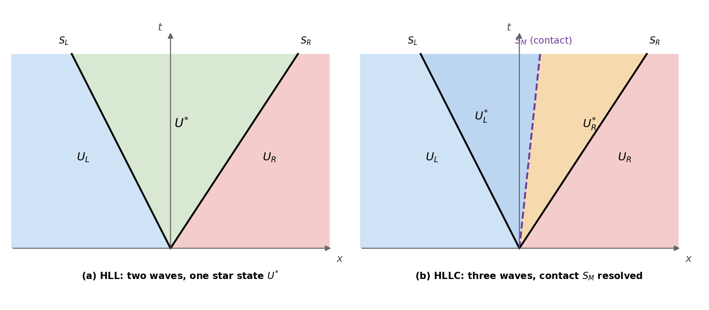

*The two approximate Riemann solvers, drawn in the x–t plane of the interface Riemann problem (left state U_L, right state U_R). **(a) HLL** keeps only the two outer waves S_L, S_R and averages everything between them into a single star state U\* — the contact discontinuity is not represented, so contacts and shear layers smear. **(b) HLLC** restores the middle contact wave S_M, splitting the star region into U\*_L and U\*_R so that contacts and tangential velocities stay sharp. LUNA uses **HLLC** by default, with **L-HLLC** (low-Mach correction) for stratified/subsonic flows and the two-wave **HLL** as a more diffusive, carbuncle-robust fallback.*

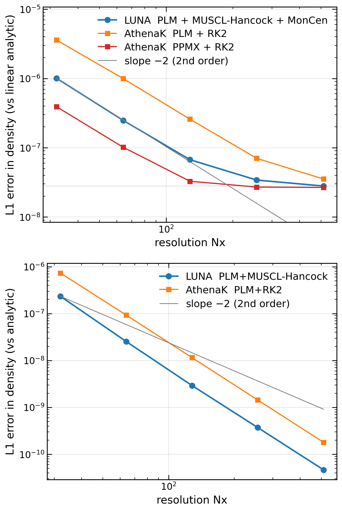

*1D linear-wave convergence (ρ₀=1, p₀=0.6, γ=5/3, ε=10⁻⁴, periodic Lx=1, one acoustic period). **Top — traveling wave:** single right-going acoustic eigenmode. LUNA (PLM + MUSCL-Hancock + MonCen + HLLC) tracks AthenaK PLM+RK2 over the full Nx range; all curves approach the same O(ε²) nonlinear-steepening floor — the residual difference between the actual nonlinear wave and the linear analytic reference, identical in both codes (AthenaK PPMX shown as a higher-order reference). **Bottom — standing wave:** same parameters with the u=0 superposition IC. The standing-wave symmetry cancels the O(ε²) nonlinear corrections, so the floor disappears and convergence runs cleanly to ~10⁻¹⁰ at Nx=512; both LUNA and AthenaK PLM+RK2 converge faster than the formal 2nd-order rate (a known symmetry-driven superconvergence). AthenaK L1 here is read from its built-in double-precision error output, not the float32 snapshot.*

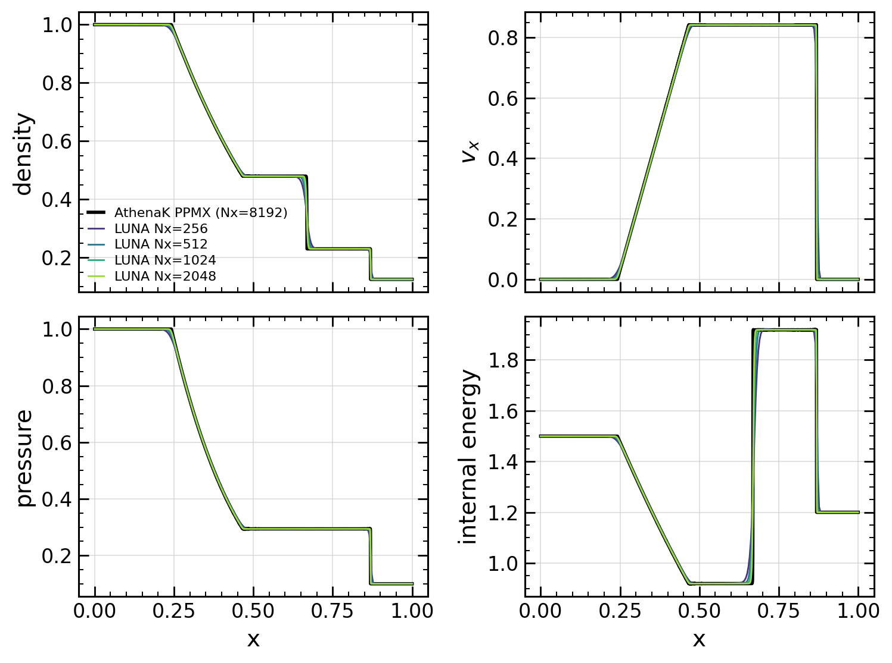

*Sod shock tube (Riemann problem with ρ_L=1, p_L=1, ρ_R=0.125, p_R=0.1; t=0.2). LUNA (PLM + MUSCL-Hancock + minmod + HLLC) at Nx ∈ {256, 512, 1024, 2048} vs AthenaK PPMX at Nx=8192. Density, vx, pressure, and specific internal energy all match the reference solution; the shock, contact discontinuity, and rarefaction fan are well resolved at Nx=512 and above.*

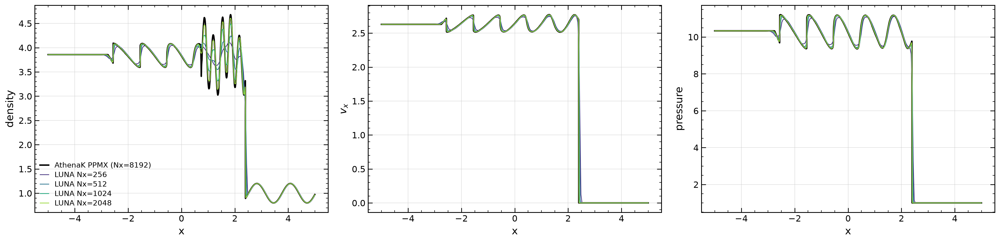

*Shu-Osher problem (M=3 shock impinging on a sinusoidal density field; t=1.8 on x ∈ [−5, 5]). Tests the scheme's ability to resolve small-scale features in the presence of strong shocks. AthenaK PPMX (8192) captures the post-shock oscillations cleanly; LUNA at Nx=2048 matches in the smooth regions and resolves the high-frequency train progressively from Nx=256 upward.*

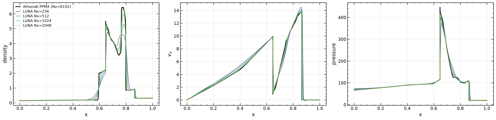

*Woodward-Colella interacting blast waves (P_L=1000, P_M=0.01, P_R=100; t=0.038, reflecting walls). Tests strong shocks with extreme pressure ratios (10⁵). LUNA captures the central density spike at x≈0.87 with the expected refinement behavior — Nx=256 underestimates the peak height; Nx=2048 essentially matches AthenaK PPMX 8192.*

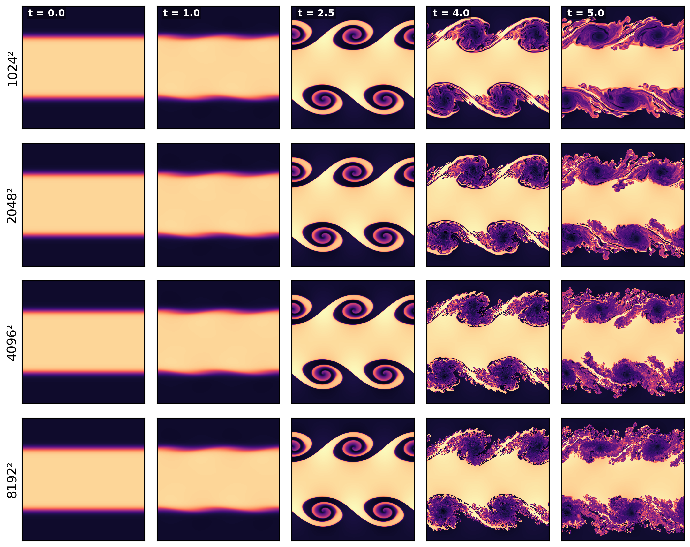

*2D Kelvin-Helmholtz instability (double-tanh shear layers at y=0.5 and y=1.5 on Lx=Ly=2, periodic, γ=5/3; LUNA PLM + MUSCL-Hancock + MonCen + HLLC at CFL=0.4). Rows are resolutions Nx² ∈ {1024², 2048², 4096², 8192²}; columns are density snapshots at t = 0, 1, 2.5, 4, 5. Higher resolution resolves progressively finer secondary roll-ups and the small-scale mixing layer between the two shear regions; by 8192² the cascade is well-resolved down to ~10 cells. Single-node (4×A100) for 1024²–4096², 4×A100 with longer walltime for 8192².*

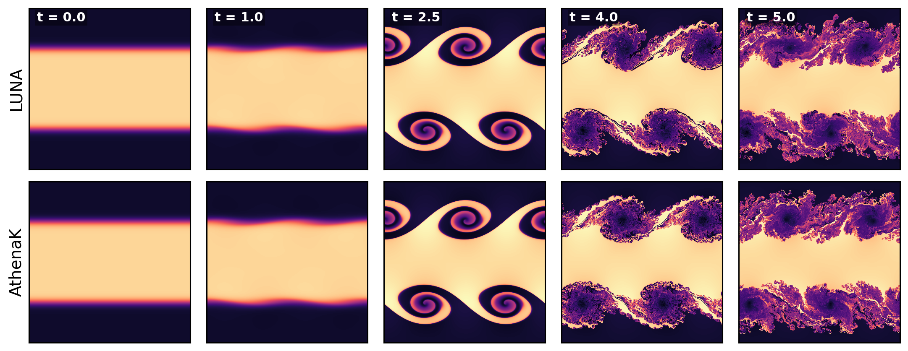

*Same KH instability at the highest resolution, LUNA vs the AthenaK 8192² WENOZ+HLLC reference (top: LUNA PLM+MUSCL-Hancock+MonCen+HLLC; bottom: AthenaK 4th-order WENOZ+HLLC, run on 2×A100 nodes via MPI+CUDA). Density slices at t = 0, 1, 2.5, 4, 5. Both codes capture the same large-scale roll-up structure; AthenaK's WENOZ keeps the small-scale braids slightly sharper, as expected for a higher-order scheme. The agreement of the dominant vortex positions and overall mixing layer shows that LUNA's 2nd-order MUSCL-Hancock pipeline is converged to AthenaK at this resolution.*

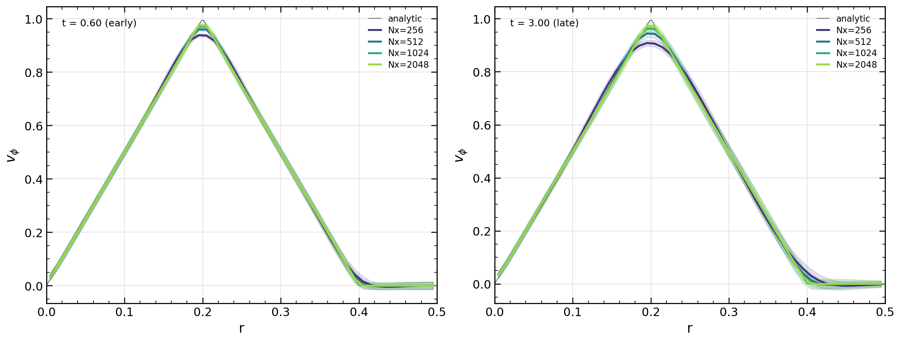

*2D Gresho vortex (Gresho & Chan 1990, low-Mach variant) — diagnostic for low-Mach behaviour of the Riemann solver. Domain [0,1]², ρ=1 uniform, p chosen for centrifugal balance with M_max = u_max/c_s = 0.01 (deep low-Mach regime). Analytic v_φ(r) is piecewise-linear with a peak at r=0.2 and v_φ=0 outside r=0.4. LUNA PLM + MUSCL-Hancock + MonCen + **HLLC** at CFL=0.4. Left: early state (t ≈ 0.5, less than one core turnover); right: late state (t=3, ≈ 2.4 turnovers). Resolution sweep Nx ∈ {256, 512, 1024, 2048}; shaded bands show ±1σ azimuthal scatter per bin. HLLC's low-Mach over-dissipation visibly flattens the analytic v_φ peak over time, with higher resolution mitigating but not eliminating the loss. This is the canonical test motivating the L-HLLC low-Mach correction (Velasco-Romero & Teyssier 2025) used for our stratified solar-convection runs.*

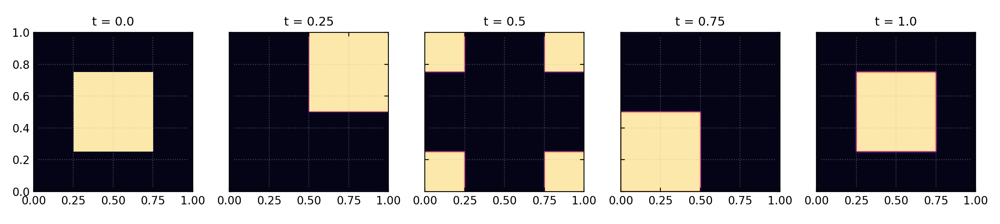

*2D square-density advection (ρ=2 in [0.25,0.75]², ρ=1 outside; uniform u=v=1, p=1, γ=5/3; periodic Lx=Ly=1; LUNA PLM + MUSCL-Hancock + MonCen + HLLC at Nx=1024² with CFL=0.4). Density snapshots at t = 0, 0.25, 0.5, 0.75, 1.0 — the square advects diagonally and after one full traversal (t=1) the velocity has carried it exactly back to the center. Tests that the scheme preserves a sharp tangential contact under uniform-flow advection over the full domain length.*

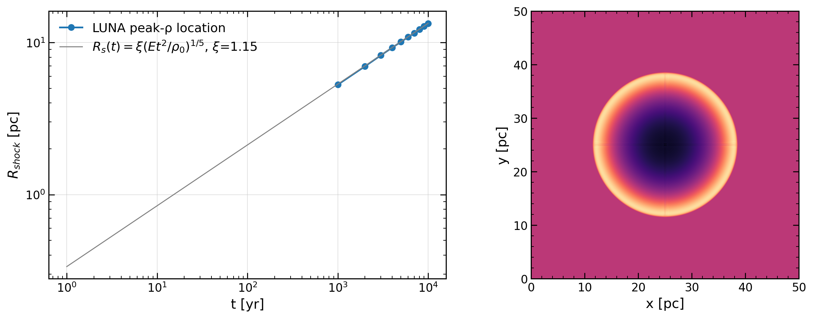

*Sedov-Taylor 3D blast wave: E = 10⁵¹ erg deposited into the central 2×2×2 = 8 cells of a uniform n = 1 cm⁻³, T = 10⁴ K ISM (γ=5/3) on a 50 pc cube; outflow boundaries. LUNA PLM + MUSCL-Hancock + minmod + HLLC at CFL=0.4, units kpc / 10¹⁰ M☉ / km s⁻¹, run for 10⁴ yr. The figure auto-uses the highest-resolution LUNA Sedov run on disk (currently Nx=512³). Left: simulated shock radius (peak-ρ location) vs the Sedov-Taylor self-similar prediction R_s(t) = ξ(E t²/ρ₀)^(1/5) with ξ=1.15 — agreement to <1% at t = 10⁴ yr. Right: column density projection along z showing the spherical blast shell.*

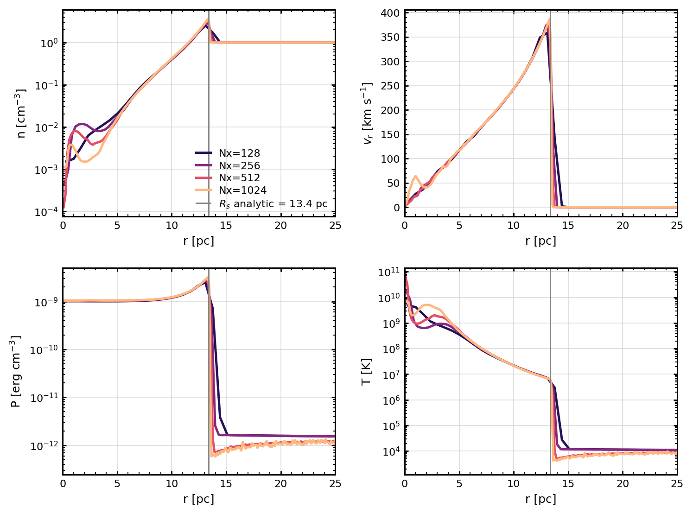

*Sedov 3D resolution study: spherically-averaged radial profiles at t = 10⁴ yr of number density n [cm⁻³], radial velocity v_r [km/s], pressure P [erg/cm³], and temperature T [K] for every LUNA Sedov run on disk (currently Nx=128³, 256³, 512³). Curves shaded by resolution; dashed line marks the analytic Sedov-Taylor shock radius. As Nx increases the shock peak sharpens toward the Rankine-Hugoniot strong-shock ratio (ρ₂/ρ₁ = 4 for γ=5/3) while the central rarefaction deepens.*

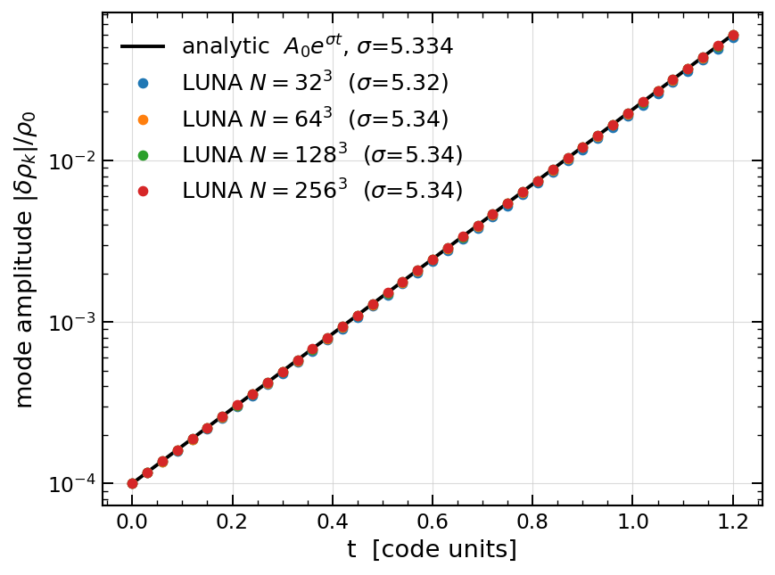

*Linear Jeans instability against analytic linear theory. Periodic self-gravitating box seeded with the growing Jeans eigenmode (adiabatic δP = c_s²δρ plus the matching longitudinal velocity), so the unstable mode grows as a clean exponential δρ ∝ e^{σt} with σ = √(4πGρ₀ − c_s²k²). LUNA's measured mode amplitude (points) at **N = 32³, 64³, 128³, 256³** all track the analytic A₀e^{σt} (black) to **σ_meas = 5.32–5.34 vs σ_exact = 5.334 (≤ 0.3%)**, converging with resolution. The underlying FMG multigrid Poisson solver is itself accurate to 0.08% on the analytic single-mode potential and converges to a 10⁻¹⁴ residual.*

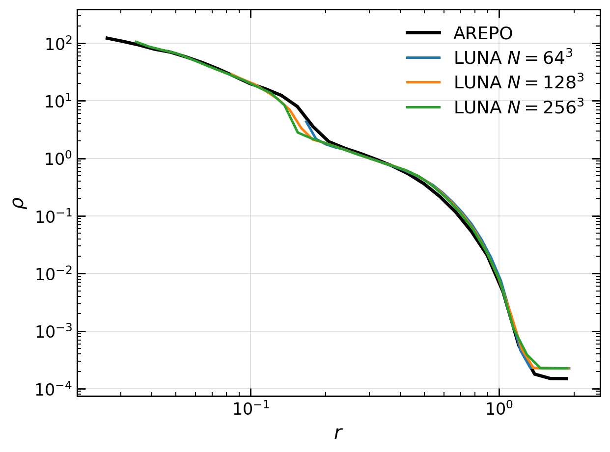

*Evrard 1988 adiabatic spherical collapse vs AREPO (Springel 2010 moving-mesh code) at t = 0.8 (Springel 2010 Fig 41 reference time). Identical ICs in code units (M = R = G = 1, ρ ∝ 1/r, u₀ = 0.05, γ = 5/3) in a periodic L = 4 box. The radial density profile is shown for LUNA at N = 64³, 128³, 256³ (coloured) against AREPO (black): LUNA converges toward the reference through the accretion shock at r ≈ 0.15 and the free-fall envelope as the grid is refined, with the higher-resolution runs reaching progressively deeper into the post-bounce central density that the coarse fixed grid cannot.*

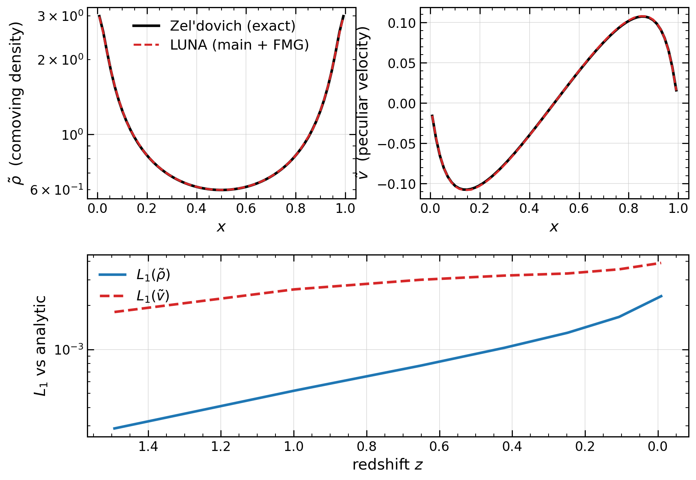

*Cosmological (super-comoving) integration — the **Zel'dovich pancake**, run end-to-end through `main` with the FMG multigrid self-gravity. A single sinusoidal mode collapses in an Einstein–de Sitter universe; LUNA integrates the **super-comoving** Euler equations (RAMSES / Martel–Shapiro variables ρ̃ = a³ρ, ṽ = a·v_pec, P̃ = a⁵P, super-comoving time dτ = dt/a²) with the gravity source coefficient **4πG → (3/2)Ωₘ a(τ)** and `dloga`-capped timesteps advanced through the cosmological a(τ) table. Evolved from z = 2.33 (a = 0.3) to **z = 0**, deep into the nonlinear regime (ρ̃_max grows 1 → 3, just shy of the caustic at z_c = −1/3): LUNA (red dashed) tracks the exact pre-caustic Zel'dovich solution (black) to **L1 = 2.3×10⁻³ (density), 3.9×10⁻³ (velocity)** in both the collapsing density pancake and the sawtooth peculiar velocity. This validates the comoving time integration and the multigrid Poisson coefficient swap — the gateway test toward cosmological-volume simulations.*

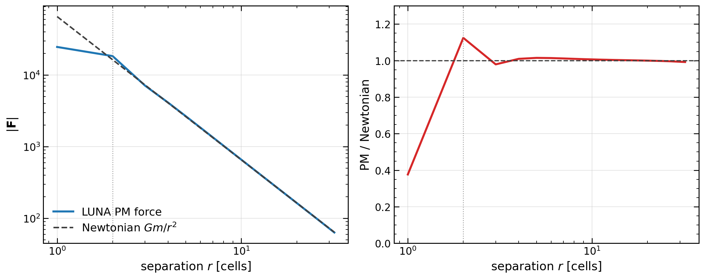

*Particle–mesh **force accuracy** vs the Newtonian 1/r². Two equal point masses are cloud-in-cell deposited onto the PM grid and the force on one is measured as a function of separation (in cells). **Left:** the LUNA PM force (blue) tracks the analytic Gm/r² (dashed) down to ~3–4 cells. **Right:** the PM/Newtonian ratio holds to ~1% for r ≳ 4 cells and rolls off below ~2 cells, where the cloud-in-cell assignment softens the force — the effective force softening is ~1.2 cells, exactly as expected for a CIC–PM scheme.*

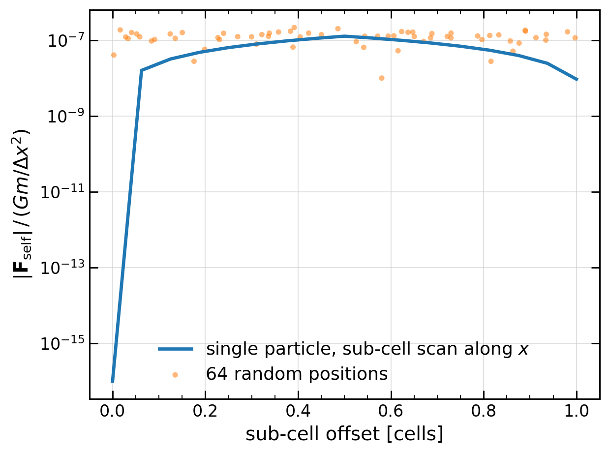

*CIC **self-force cancellation** — a single particle must feel zero force from its own density deposit. Scanning one particle across a cell (blue) and at 64 random positions (orange), the residual self-force stays at ~10⁻⁷ of Gm/Δx² (and falls to machine zero when the particle sits exactly on a grid node), confirming the deposit → FMG-solve → anti-symmetric gradient → gather chain is self-force-free by construction. Together with the 1/r² test above this validates LUNA's gravity solver **end to end**, from the pairwise force law to self-consistency.*

## Parallel scaling

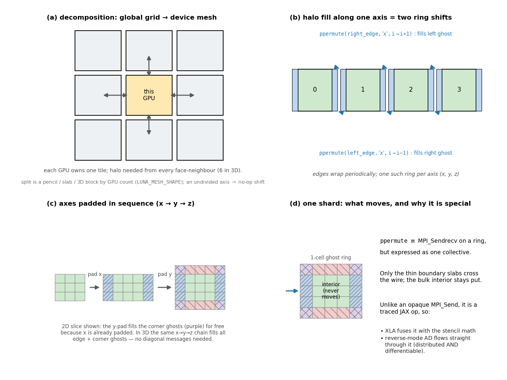

*How LUNA does multi-GPU communication — the mechanism behind the scaling below. **(a)** The global grid is split across the device mesh — a pencil, slab, or 3D block by GPU count, set by `LUNA_MESH_SHAPE` — and each GPU owns one tile that needs a one-cell **halo** from every face-neighbor. **(b)** Along each mesh axis the halo is filled by two ring shifts: `jax.lax.ppermute(right_edge, 'x', i→i+1)` sends every GPU's right-edge slab to neighbor `i+1` (becomes their left ghost) and `perm_to_left` does the mirror — repeated for x, y, z, with edges wrapping periodically. **(c)** The axes are padded in sequence `x→y→z`, so each later axis operates on the already-padded array and the **edge + corner ghosts fill for free**, with no diagonal messages. **(d)** Only the thin boundary slabs ever cross the wire; the bulk interior never moves. The key difference from classic MPI: each `ppermute` is exactly an `MPI_Sendrecv` around a Cartesian ring, but it's a *traced JAX op* — so XLA fuses it with the stencil math **and reverse-mode autodiff flows straight through it**, which is what lets LUNA be distributed *and* differentiable at once (an `MPI_Send` is an opaque black box you can't backprop through). The alternative `jnp.pad` + auto-sharding path lets the compiler infer the communication, but it can balloon scratch buffers and run much slower, while the explicit-halo path gives bit-comparable results.*

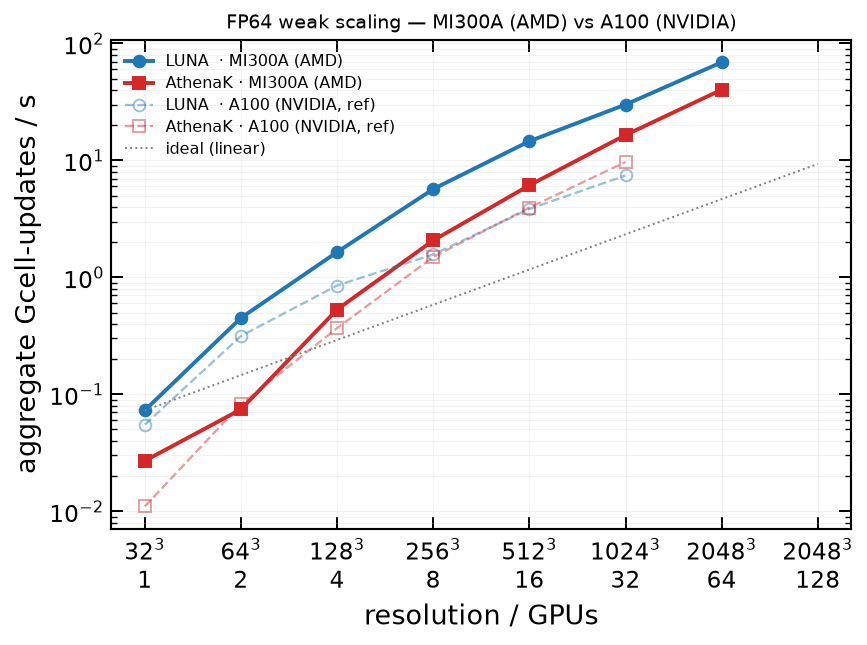

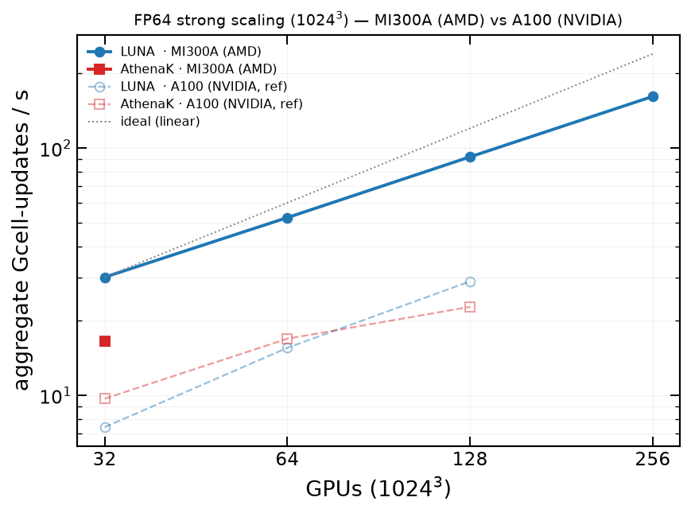

*Multi-GPU throughput on the 3D Sedov-Taylor blast, **matched double precision (FP64)**, LUNA (shard_map, explicit `ppermute` halos) vs AthenaK (RK2 + PLM + HLLC) on NVIDIA A100s — aggregate Giga cell-updates/s. Fair 2nd-order comparison (both PLM + HLLC + 2nd-order time, same CFL=0.4); LUNA throughput is the steady-state per-step rate (JIT-compile warmup excluded), AthenaK is its end-of-loop `zone-cycles/cpu_second`. **Top — weak scaling:** grid grows with device count, 32³@1 → 1024³@32 GPUs (2048³@64 in flight). LUNA leads by 2–5× where the per-GPU subdomain is small (latency-bound), and the two converge to within a few percent once the GPUs saturate (256³–512³, memory-bandwidth-bound, both at the roofline). **Bottom — strong scaling:** fixed 1024³ from 32 GPUs upward (64/128-GPU points in flight). Takeaway: LUNA is throughput-competitive with a mature, heavily-optimized finite-volume code **while staying end-to-end differentiable** — see the [autodiff section](#differentiable-simulation-autodiff).*

## Differentiable simulation (autodiff)

LUNA's hydro step, gravity solve, and source terms are end-to-end differentiable (JAX), forward and reverse mode, through the *production* solver. Four demonstrations: **(1)** the gradients are validated against **analytic** ground truth; **(2)** a signature showcase — an arbitrary late-time target reconstructed by optimizing the initial conditions through a long, nonlinear evolution; **(3)** inverse modeling — recovering initial conditions through radiative cooling and self-gravity; and **(4)** machine learning embedded *inside* the solver, a solver-in-the-loop flux corrector trained through the rollout.

### 1 · Gradient correctness

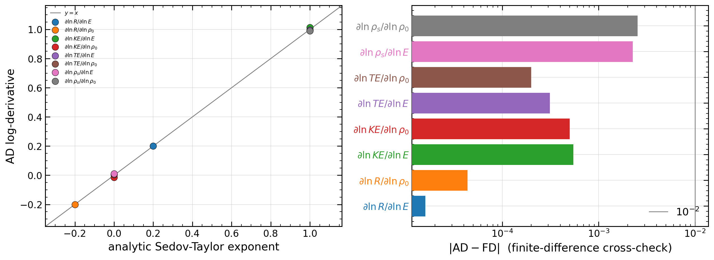

*Forward-mode AD through the full Sedov blast (32³, 200 steps) reproduces the **analytic** self-similar exponents — ∂lnR/∂lnE = +1/5, ∂lnR/∂lnρ₀ = −1/5, the KE/TE energy partition, the Rankine-Hugoniot density jump — every point on the y = x line (left), matching central finite differences to < 10⁻² (right). The gradient is checked against **analytic ground truth**, not just FD — a bar that standard prior differentiable-hydro work does not meet.*

### 2 · Signature — "LUNA out of the explosion set"

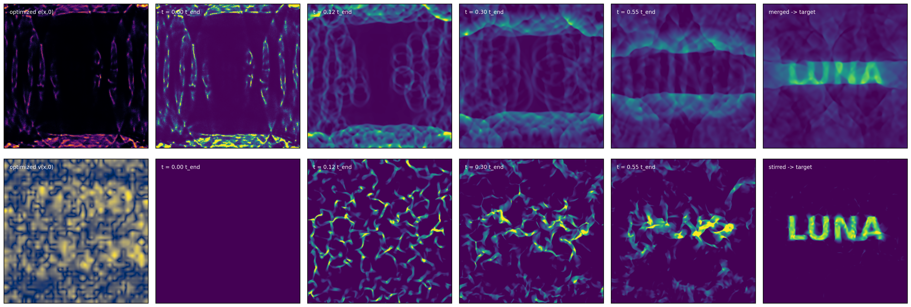

*Two ways to make the word **LUNA** emerge from a physical simulation by optimizing only the initial conditions through a long, nonlinear evolution. **Top — blast-driven:** the free parameter is the **entire per-cell initial internal-energy field** e(𝐱,0) of a uniform medium at rest — no placed seeds — optimized by reverse-mode AD through the production 2D solver. Initialized **uniform** and matched to the target only after a **long evolution** (~0.4 domain sound-crossings): in a cold medium every energy peak launches an *outgoing* Sedov blast, so a target-shaped IC physically cannot survive — the only way to reach the late-time target is to seat scattered blast sites whose shells **collide and converge**. The left panel (the converged e(𝐱,0)) is a **disordered ensemble of Sedov sites that does not spell anything**; the snapshots (left → right) show those blasts expanding, colliding, and merging into a curved shock network whose late-time energy forms the word. The word is produced by the collision dynamics, not the initial layout — the IC could not have been assembled by hand. **Bottom — turbulence-driven:** the driver is instead a band-limited initial **velocity field** v(𝐱,0) of an isothermal, uniform-density gas, optimized so the gas it **stirs and compresses** has a late-time density matching the target. The left panel is the optimized velocity field — a multi-scale swirling pattern that **does not spell anything**; the snapshots show the uniform gas advected and compressed along the converging streamlines into a filamentary network whose late-time **density** forms the word. (Both 256²; blast on 4 GPUs, turbulence at Mach ≈ 3, isothermal. The same recipe applied to an arbitrary photograph — you + Luna — runs through the identical pipeline.)*

### 3 · Inverse modeling — IC recovery through cooling and self-gravity

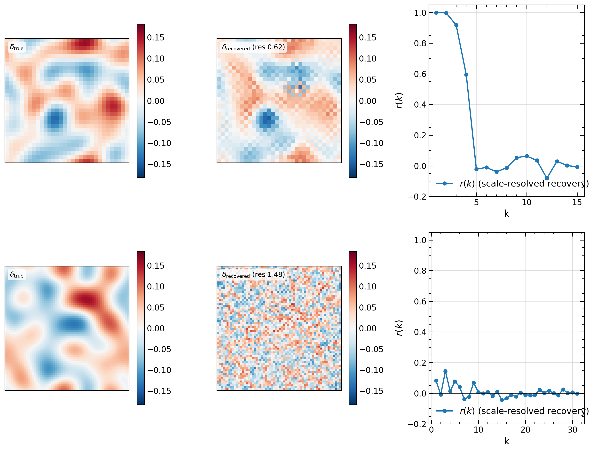

*Reverse-mode IC inversion through two different physics modules; each panel shows δ_true, δ_recovered, and the spectral correlation r(k). **Top — radiatively-cooling flow:** recover the initial energy perturbation from the evolved state by reverse-mode AD through the production cooling solver. r(k) ≈ 1 out to k ≈ 4–5 then collapses — the dissipative recovery limit set by cooling (low-resolution demo at Nx 32; the 256³ version runs on the same 4-GPU auto-sharded adjoint path). **Bottom — self-gravitating collapse:** recover the initial density perturbation through LUNA's differentiable FMG-Poisson solve. The gravity adjoint is an implicit-function custom-VJP, **finite-difference-verified to machine precision**, so the gradient backpropagates correctly through gravitational collapse (Nx 64; 256³ on the same sharded path). Together the two panels cover IC recovery through both radiative cooling and self-gravity, run through LUNA's production solver.*

### 4 · Solver-in-the-loop — embedded neural flux corrector

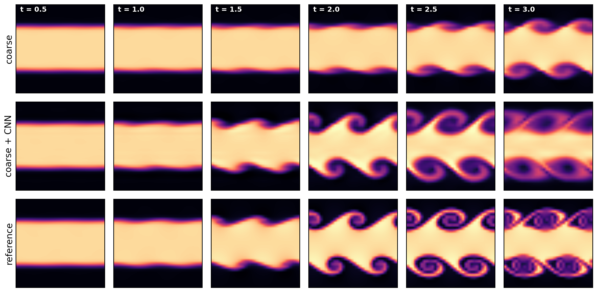

*Machine learning **inside** the solver. A convolutional flux-correction network B_θ is embedded in the update, `U ← step(U, Δt) + ∇·B_θ(U)`, and trained end-to-end by reverse-mode AD through the **unrolled** coarse rollout — a solver-in-the-loop flux corrector (Um et al. 2020) on **our own 2D KH instability**. The point of the corrector is to compensate for *under-resolution*, so the coarse grid is deliberately starved: **32² coarse → 256² fine (8×)**, a **self-referential** LUNA target downsampled to the coarse grid (no external code in the loop). Because the correction is emitted as a flux divergence it is **conservative by construction**. Density at t = 0.5 → 3.0: the bare 32² solver (over-diffuse) barely rolls up at all; the 32² solver **+ CNN** recovers the billows and their vortex cores, closely tracking the 256² reference.*

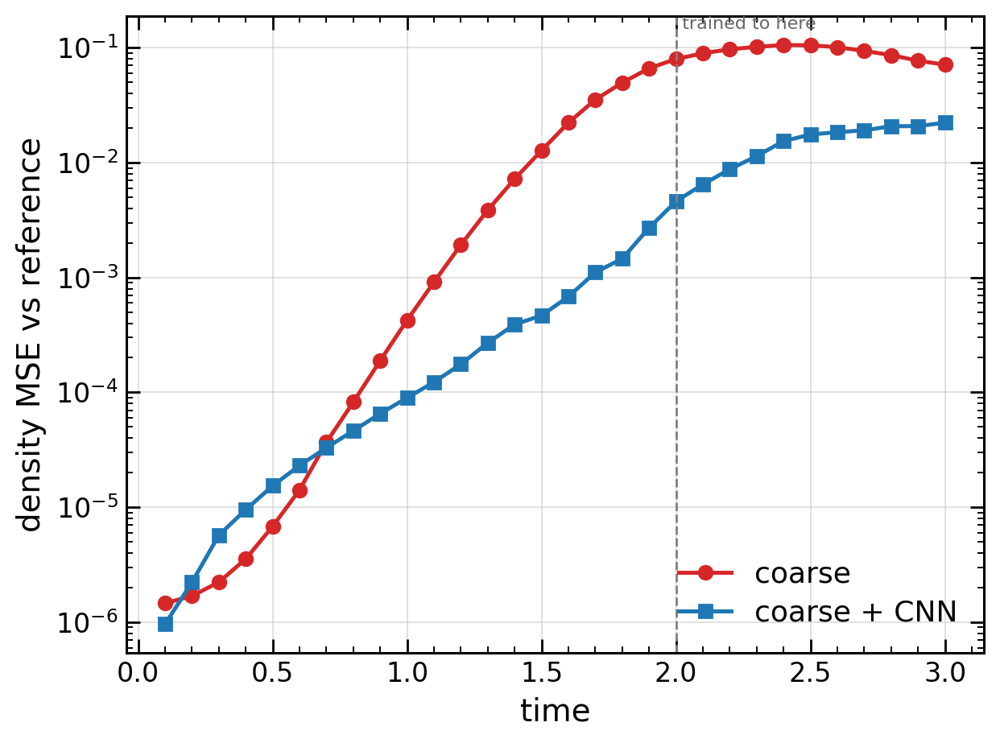

*Density MSE vs the 256² reference over the rollout. Trained only to t = 2 (dashed line, into the nonlinear billow phase), the corrected rollout (blue) stays **roughly an order of magnitude below** the uncorrected coarse solver (red) and remains stable to t = 3, cutting the t = 3 density error by **~70%**. The residual gap is the tightest spiral windings of the reference — some of which is below what a 32² grid can represent.*

## Science applications

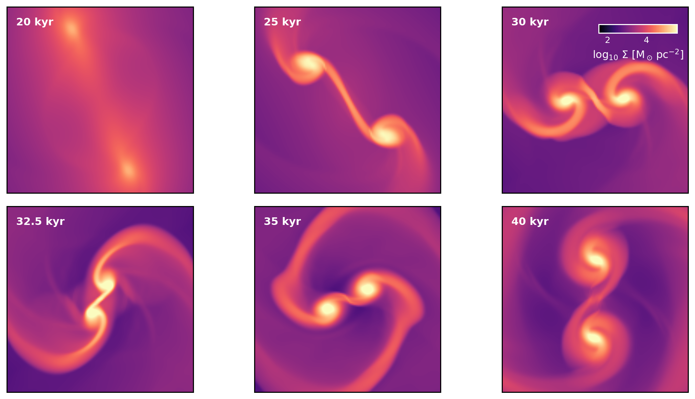

*Boss & Bodenheimer 1979 rotating protostellar collapse at 256³ with **on-the-fly sink particles** (`sources/sinks.py`), set up to match **SEREN (Hubber et al. 2011) §10.9** exactly: M = 1 M⊙, R = 3.2×10¹⁶ cm, ρ₀ = 1.44×10⁻¹⁷ g/cm³, ρ = ρ₀[1 + 0.5·sin 2φ], solid-body Ω = 1.6×10⁻¹² rad/s, **barotropic EOS** T(ρ) = 10 K·[1 + (ρ/10⁻¹⁴)^(γ−1)], sink formation at ρ = 2×10⁻¹² g/cm³, in physical (pc, M⊙, km/s) units. Column density log₁₀Σ [M⊙ pc⁻²] along the rotation axis, central ±0.005 pc, at t = 20, 25, 30, 32.5, 35, 40 kyr. The m = 2 perturbation collapses to a bar that fragments into the canonical **bar → binary**: two dense protostellar cores with trailing spiral arms. Sinks form in the cores and integrate by the hybrid scheme — multigrid Poisson for the gas self-gravity and gas→sink force, direct softened N-body for sink→gas and sink→sink (so the close protobinary is resolved, not grid-softened). Self-gravity uses the isolated multipole-Dirichlet Poisson BC + a diode (outflow-only) hydro BC.*

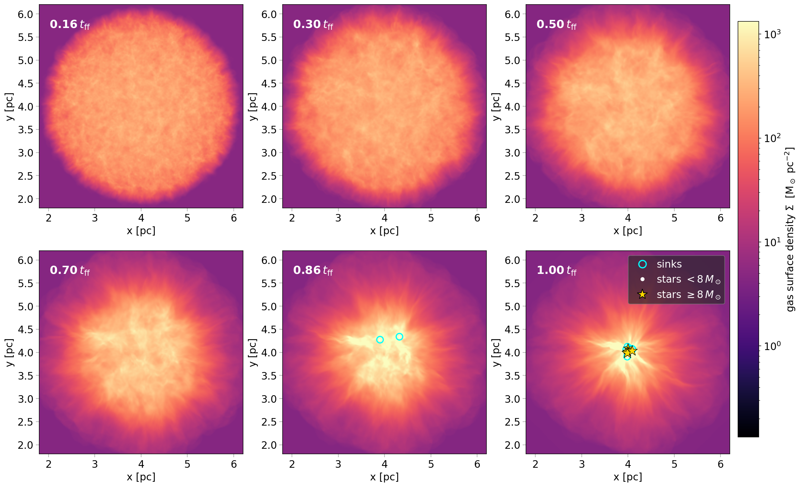

*LUNA coupled into the **Torch/AMUSE** framework as a FLASH replacement: a 2000 M⊙, R = 2 pc, T = 15 K turbulent cloud (Mach 5, t_ff ≈ 1.05 Myr) collapsing on a **512³** grid (single node, 4× A100), run to one free-fall time. Gas **surface density** Σ in the x–y plane at t/t_ff = 0.16, 0.30, 0.50, 0.70, 0.86, 1.00; **sinks** are blue circles, **stars** white markers sized by mass. The cloud goes from a turbulent sphere through a filamentary network to a central collapse: the first sinks/stars appear at ~0.86 t_ff (2 sinks, 6 stars) and by 1 t_ff there is a central cluster (8 sinks, 582 stars). LUNA's sinks are sampled into an IMF of stars by Torch's `torch_sf`, handed to **ph4** (N-body) and **SeBa** (stellar evolution), with wind/SN feedback returned to the gas — the whole pipeline sharded across GPUs via `shard_map` (N-body on rank 0, star state broadcast to all ranks). Gravity is three-way: **gas–gas** and **gas–star** (both directions) on LUNA's multigrid particle-mesh, **star–star** in ph4; ph4/SeBa are driven with time relative to first formation so newly-born stars stay on their sink (mean star–sink ≈ 0.05 pc). The runaway central collapse converts ~20 % of the cloud to sinks/stars by 1 t_ff (pre-feedback regime; SN regulation needs the first massive stars to evolve off the MS, ≫ the ~1 Myr shown).*

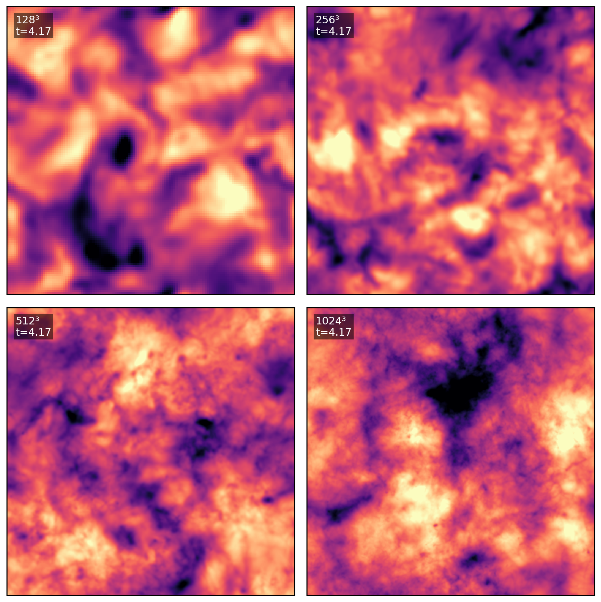

*Subsonic (M_rms = 0.3) driven isothermal turbulence at t ≈ 4 (≈1.2 turnover times): density slice through z = L/2 for a resolution sweep Nx³ ∈ {128³, 256³, 512³, 1024³}. Solenoidal-only OU forcing (Federrath/Schmidt 2010) on a 1³ periodic box, k_min=1, k_max=2 driving range, identical PRNG seed at every Nx so the driven realisation matches. EOS: LUNA solves γ=5/3 Euler internally for HLLC robustness, but the runner enforces p = c_s² ρ as an operator-split post-step projection (soft isothermal thermostat) — no spurious compressive heating accumulates. The 1024³ run is on a 2-node × 4-GPU schedule slot.*

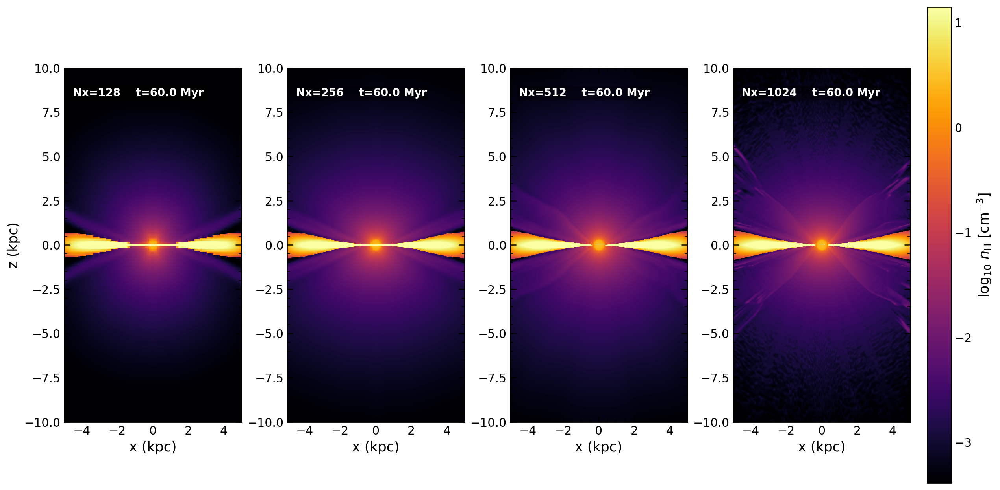

*3D M82-like starburst wind following the Schneider, Robertson & Thompson (2018) CC85 setup: rotating exponential isothermal gas disk (M_gas = 2.5 × 10⁹ M⊙, R_d = 1.6 kpc, R_trunc = 4.5 kpc, T = 10⁴ K) in vertical hydrostatic equilibrium within a static Miyamoto-Nagai stellar disk (M⋆ = 10¹⁰ M⊙, a = 0.8 kpc, b = 0.15 kpc) + NFW halo (M_vir = 5 × 10¹¹ M⊙, c = 20) potential, plus CC85 central spherical injection (R_⋆ = 300 pc; SFR = 12 M⊙/yr, η_M = 0.3, η_E = 0.6 → Ṁ = 3.6 M⊙/yr, Ė ≈ 2.3 × 10⁴² erg/s, v_∞ ≈ 1400 km/s). Hot CGM ambient (n = 10⁻⁴ cm⁻³, T = 10⁶ K) fills the rest of the 10 × 10 × 20 kpc box; Sutherland & Dopita (1993) CIE cooling integrated with Townsend (2009). x–z slice through y = Ly/2 of log₁₀ n_H at t = 60 Myr. Resolution scan Nx ∈ {128, 256, 512}; the 512 panel is a placeholder for a multi-node run still in flight.*

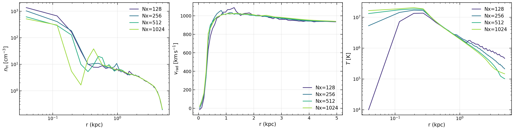

*Spherically-averaged radial profiles of n_H, v_rad, and T at t = 60 Myr for each resolution. Computed by 3D binning in radius from the box center. Useful for direct comparison against the analytic CC85 solution (n ∝ r⁻², roughly constant v ∝ v_∞ outside R_⋆, and adiabatic T ∝ r⁻⁴ᐟ³ in the steady wind) and Schneider+ 2018 CGOLS Figure 4.*

## Cosmological gas + dark matter

Before the coupled run, the **DM-only** cosmological gravity is validated head-to-head against a production cosmology code on **matched initial conditions**.

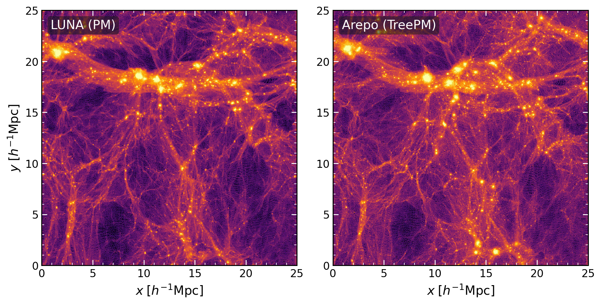

*DM-only validation against **Arepo** — the **identical** 512³ MUSIC initial condition (25 Mpc/h box, CAMELS fiducial cosmology, 134M particles) evolved z = 50 → 0 by LUNA's multigrid Particle–Mesh (left) and the Arepo TreePM moving-mesh code (right). Projected dark-matter density: the cosmic web is reproduced **structure-for-structure** — the same clusters, filaments, and voids in the same places — with LUNA's pure-PM haloes marginally smoother than Arepo's TreePM cores, the expected consequence of the grid force resolution.*


*Dark-matter **power spectrum** at z = 0 for the same run, measured with an **identical CIC estimator** for both codes. LUNA (PM) and Arepo (TreePM) track one another across the resolved range; the high-k deficit of the pure-PM scheme relative to TreePM (right panel) reflects the grid force softening below a few cells, while the large-scale modes agree. This validates LUNA's cosmological gravity and super-comoving integration against a mature production code on the same initial data.*

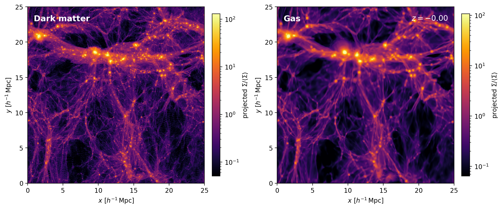

*Coupled **gas + dark-matter** cosmological run, end to end in LUNA: **512³ gas cells + 512³ DM particles** in a 25 Mpc/h box, evolved from **z = 50 → z = 0**. Projected overdensity, **dark matter (left)** and **gas (right)**: both trace the same cosmic web, but the collisionless DM clumps into sharp filaments and point-like halo cores while the pressure-supported gas is visibly smoother and more diffuse — the expected physical contrast. Initial conditions come from a **MUSIC** baryon IC (gas PartType0 + DM PartType1) read straight into `main.run`; the gas is meshed to the grid in **super-comoving** variables while the DM stays as particles, and the two are coupled through **one joint multigrid-Poisson solve per step** on the combined density (`∇²φ̃ = (3/2)Ωₘa·δ`). Gas evolves under MUSCL-Hancock + HLLC with operator-split gravity; DM under a KDK leapfrog sharing the same potential. The full run (6,803 steps to z = 0) is stable end-to-end with mass conserved to 0.02%, low-density CFL runaways tamed by velocity/temperature ceilings. Gadget/Arepo units throughout (kpc/h, km/s, 10¹⁰ M⊙/h).*

**Key Features:**
- ✅ Single-GPU and multi-GPU (JAX sharding) execution
- ✅ HLLC Riemann solver with optimized flux computation
- ✅ PLM reconstruction with multiple limiters
- ✅ Smooth limiters for automatic differentiation
- ✅ Full autodiff support with gradient visualization
- ✅ Unsplit 2nd-order MUSCL-Hancock time integration (RAMSES-style primitive predictor)

---

## Table of Contents

1. [Quick Start](#quick-start)
2. [Single-GPU Usage](#single-gpu-usage)
3. [Multi-GPU Usage](#multi-gpu-usage)
4. [Performance](#performance)

---

## Quick Start

### Setup

1. **Configuration**: Copy the template configuration file:
   ```bash
   cp template_config.py config.py
   ```
   Edit `config.py` to set your simulation parameters (grid size, test problem, etc.)

2. **Dependencies**:
   ```bash
   pip install jax jaxlib numpy h5py matplotlib
   ```

### Run Simulation

```bash
# Single- or multi-GPU: main.py initializes JAX distributed automatically
# (single process uses all visible GPUs; under SLURM, srun spawns one
# process per GPU and they coordinate via JAX_COORDINATOR_PORT).
python main.py

# Validation problems run through the runner instead (see submit/ for
# SLURM templates):
python -m scripts.validation.runs.sedov3d_run
```

---

## Single-GPU Usage

### Configuration

`config.py` is a dataclass (copied from `template_config.py`); edit the field
defaults. The knobs that matter most:

- **Test problem**: `test_problem` — any name registered in
  `ic_generation/ic.py` (e.g. `"Sod-Shock"`, `"Kelvin-Helmholtz"`,
  `"Sedov-Blast-3D"`, `"Boss-Bodenheimer-3D"`, `"CC85-Wind-3D"`)
- **Dimension / grid**: `SPATIAL_DIMENSION`, `Nx/Ny/Nz`, `Lx/Ly/Lz`
- **Scheme** (time integration is always unsplit MUSCL-Hancock):
  - `ORDER` — 0 = first-order Godunov, 1 = PLM (2nd order, default)
  - `LIMITER` — 0 = MinMod, 1 = MonCen, 2 = VanLeer
  - `riemann_solver` — `"hllc"` (default), `"hll"` (more dissipative),
    `"lhllc"` (low-Mach fix for stratified/subsonic flows)
  - `CFL` — 0.3–0.5 for 3D unsplit; up to 0.8 for 1D
- **Boundaries**: `BOUNDARY` — 0 = periodic, 1 = outflow/zero-gradient,
  2 = reflective
- **Self-gravity**: `SELF_GRAVITY=True` + `GRAVITATIONAL_G`;
  `POISSON_BOUNDARY` — inherit (None), 0 = periodic (Jeans swindle),
  3 = isolated (multipole-Dirichlet FMG)

### Example Configuration

```python
# config.py — fields inside the Config dataclass
test_problem: str = "Kelvin-Helmholtz"
SPATIAL_DIMENSION: int = 2
Nx: int = 2048
Ny: int = 2048
Lx: float = 1.0
Ly: float = 1.0
t_end: float = 2.0
CFL: float = 0.5
ORDER: int = 1        # PLM
LIMITER: int = 1      # MonCen
BOUNDARY: int = 0     # periodic
```

### Run Simulation

```bash
python main.py
```

For parameter sweeps and validation problems, skip `config.py` and use the
programmatic runner, which applies overrides on top of the template:

```python
from scripts.validation.runner import run_one
run_one(dict(test_problem="Sedov-Blast-3D", Nx=256, Ny=256, Nz=256, ...))
```

---

## Multi-GPU Usage

###  Overview

LUNA has two multi-GPU execution paths:

1. **Auto-sharding (default)** — arrays carry a `NamedSharding`; XLA inserts
   the halo communication automatically. Fine for 2D and small 3D runs.
2. **shard_map (production 3D)** — set `USE_SHARDMAP=True`. The whole
   MUSCL-Hancock step runs per-shard with explicit `ppermute` halo
   exchanges. This sidesteps XLA's auto-sharding working-set blowup and is
   what the 1024³ production runs use.

Mesh decomposition is controlled by `DECOMPOSITION` ("auto"/"slab"/"block")
or pinned exactly with `MESH_SHAPE` (e.g. `(2, 2, 4)` for 16 GPUs on 1024³).

### Quick Start

```bash
# Single node: JAX automatically uses all visible GPUs
python main.py

# Multi-node under SLURM: one process per GPU via srun (see submit/ templates)
srun python -u -m scripts.validation.runs.sedov3d_run
```

### Multi-process rules (hard-won)

- Build per-cell sharded arrays from local slices via
  `make_array_from_single_device_arrays` — a full-array `device_put`
  deadlocks silently multi-node.
- Pass sharded arrays as JIT *arguments*, never capture them in Python
  closures (XLA tries to inline them as constants and crashes).
- 1024³ float32 3D needs ≥16 GPUs with `MESH_SHAPE=(2, 2, 4)`; the MUSCL
  working set (~23 full-shard arrays) does not fit 8 A100-40GB.

---

## Production usage

For long-running production campaigns:

- **NaN abort guard**: the time loop checks for non-finite state after every step (free piggyback on `compute_dt`). On detection it retries the step with halved CFL up to **8 times** (i.e., `dt → dt/256`). If the state is still bad it dumps an emergency checkpoint (`cfg.enable_checkpointing` is default-on) and raises `RuntimeError` so SLURM exits non-zero. No more silent multi-hour NaN'd runs.
- **Periodic diagnostics**: every `cfg.diag_interval` steps the runner prints `min(rho), min(P), max(|v|), max(M)` and appends a row to `<output_dir>/history.csv` (Athena++-style `.hst` analog) for offline analysis.
- **Determinism**: validated submit scripts in `submit/` export `XLA_FLAGS="--xla_gpu_deterministic_ops=true"`. Together with `enable_x64=True` (set in run scripts) this gives bitwise-reproducible runs at fixed sharding.
- **Source terms** live in `sources/` (`ou_forcing`, `cc85`, `external_gravity`, `cooling`, `self_gravity`). Each returns a `{"apply": fn(U, dt)}` callable that the runner operator-splits after the hydro step. Adding a new source term means writing one `sources/X.py` and one line in `setup/runner_distributed.py`.
- **Multi-node**: the validated pattern (`submit/submit_m82_multi.sh`, `submit/submit_kh_multi.sh` and the other `*_multi`/`*_8node` scripts) uses `--mem=500000`, `--constraint=gpu`, `--gres=gpu:4`, `JAX_COORDINATOR_PORT=12345`. SLURM logs land in `slurm_logs/`. Lessons from earlier multi-node debugging:
  - Build all sharded auxiliary arrays via the KH-IC pattern (local-slice + `make_array_from_single_device_arrays`); naïve full-array `device_put` deadlocks multi-process.
  - Pass sharded arrays as JIT *arguments*, not as Python closures — XLA tries to inline closure-captured sharded arrays as MLIR constants and crashes with "Fetching value for jax.Array that spans non-addressable devices".

---

## Performance

### Single-GPU Optimization

**Optimizations completed:**
1. ✅ Specialized 1D/2D/3D HLLC functions (memory-friendly per-component
   `jnp.where` chains instead of stacked intermediates)
2. ✅ Direction-by-direction predictor accumulation with
   `optimization_barrier` (3D working set never holds three slope arrays)
3. ✅ Optimized reflective boundaries
4. ✅ Reciprocal caching in HLLC

**Measured:** ~12% HLLC speedup from the flux rework (2.86 ms → 2.52 ms
per flux call on a 4096² grid, A100).

### Multi-GPU Scaling

Early 2D auto-sharding measurements (2048² strong scaling on one A100 node)
showed ~95% efficiency at 2–8 GPUs. For production 3D the relevant numbers
are from the shard_map path:

- **Sedov 1024³ float32**: runs on 16 A100-40GB (4 nodes × 4),
  `MESH_SHAPE=(2, 2, 4)`, `USE_SHARDMAP=True`. 8 GPUs OOMs — the unsplit
  MUSCL working set needs the 16-GPU shard size.
- shard_map vs auto-sharding at the same node count gave a major step-time
  improvement at 1024³ (XLA's auto-sharded 3D step materializes large
  scratch buffers that the explicit per-shard pipeline avoids).
- Keep ≥256³ cells per GPU for good compute/halo ratio.

---

## Citation

If you use this code in your research, please cite:

```bibtex
@software{luna,
  author = {Steinwandel, Ulrich Philipp},
  title  = {LUNA: A Differentiable Astrophysical Hydrodynamics Code},
  year   = {2026},
  url    = {https://github.com/usteinwandel/luna}
}
```

---

## License

[Add your license here]

---

## Contributing

Contributions welcome! Please:
1. Fork the repository
2. Create a feature branch
3. Add tests for new features
4. Submit a pull request

---

## Support

For questions or issues:
- Open an issue on GitHub
- Check this documentation

---

**Last Updated:** 2025-12-02
**Status:** Production-ready for single-GPU, multi-GPU (JAX sharding) works on NVIDIA, issues on AMD ROCm
