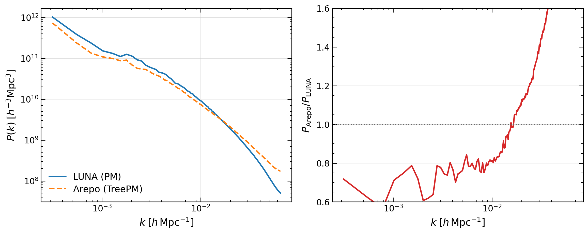
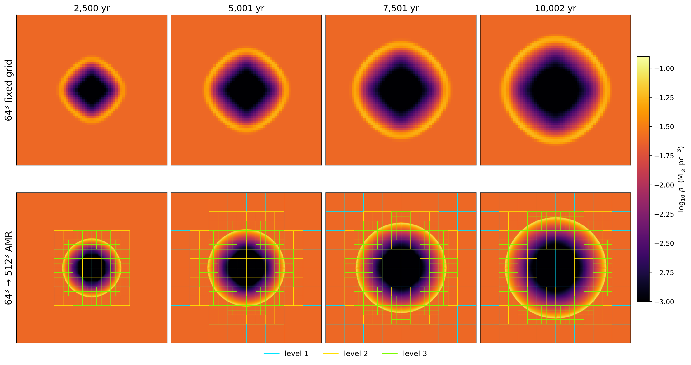
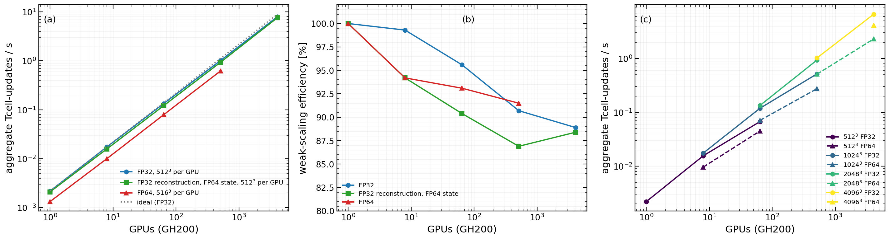

# LUNA

[](https://doi.org/10.5281/zenodo.23874689)

LUNA is a differentiable astrophysical hydrodynamics code written in
[JAX](https://docs.jax.dev), with hand-written
[Pallas](https://docs.jax.dev/en/latest/pallas/index.html) kernels as a fast path on
GPUs. It solves the Euler equations in one, two and three dimensions with an unsplit,
second-order MUSCL-Hancock scheme and HLLC or HLL Riemann solvers, and runs on CPUs and
on many NVIDIA or AMD GPUs, with the domain split over devices. Self-gravity is solved
with periodic or isolated boundaries and couples to the gas conserving energy; comoving
cosmology evolves gas together with dark-matter particles; radiative cooling, driven
turbulence and starburst energy and mass injection are built in. Examples of what it
does: shock tubes, blast waves and Kelvin-Helmholtz, Rayleigh-Taylor and
Richtmyer-Meshkov instabilities; Jeans collapse and collapsing self-gravitating clouds;
the cosmic web of gas and dark matter from cosmological initial conditions; driven
supersonic turbulence; galactic winds blown out of a starburst disk; and inverse
problems, such as optimising initial conditions with gradients taken through the solver.
Non-equilibrium chemistry and cooling networks, radiation transport, sink particles and
star formation with stellar dynamics and feedback through Torch/AMUSE, and block-based
adaptive mesh refinement are included as experimental modules. Validated capabilities
are tested against exact solutions, published data and AthenaK; Arepo and RAMSES runs
serve as comparisons, and all reference solutions are published with the code.

Defaults on `main`: FP32
(`enable_x64=False`), minmod limiter, HLLC, CFL 0.8, and the XLA kernel
(`hydro_kernel="xla"`), which is the reference path. A Pallas kernel is an opt-in path
for GPUs (`hydro_kernel="pallas"`); it refuses configurations it cannot run.

The reference solutions the tests compare against (AthenaK, Arepo, RAMSES, the Pencil
Code, AMReX Microphysics and others, with their sources) are public in
[luna-reference-solutions](https://github.com/Ulli1991/luna-reference-solutions)
(DOI [10.5281/zenodo.23876670](https://doi.org/10.5281/zenodo.23876670)).

## What LUNA can do

Status: **validated** = asserted by a test with a gate that does not depend on LUNA's
own error (round-off or an exact identity, a convergence order containing the
theoretical one, an AthenaK matched-method bound, published data); **regression pin** =
a test pins LUNA's own result (~1.3x its measured error, even against an exact
solution): a change is caught, correctness is not shown; **shown** = real runs, shown in
figures, not asserted by a test; **experimental** = under development, not finalised. Each row's tests and details are in
[docs/CLAIMS.md](docs/CLAIMS.md).

| capability | status |
|---|---|
| Euler hydrodynamics in 1D, 2D, 3D: unsplit MUSCL-Hancock, PLM (minmod, MC, van Leer), HLLC | validated |
| Shock tubes, Noh and Guderley implosions against exact solutions; Shu-Osher, Woodward-Colella, Titarev-Toro, Liska-Wendroff implosion and Kurganov-Tadmor 3 against AthenaK, same method and resolution | validated |
| Sedov-Taylor blast; Richtmyer-Meshkov growth; nonlinear Kelvin-Helmholtz (McNally et al. 2012) | regression pin |
| `riemann_solver="hll"`: the robust fallback where HLLC carbuncles at grid-aligned strong shocks; chosen by the user, never switched automatically | regression pin |
| Multi-GPU domain decomposition: a sharded run equals the single-device run bitwise for hydro (`test_hydro_hard_sedov_offaxis.py:262`, `test_hydro_hard_mcnally_kh.py:318`, `test_hydro_hard_implosion.py:199`, `test_hydro_hard_kt_riemann.py:335`); to rel 2.5e-12 for gravity (`test_gravity_decomposition.py:61`), 1e-12 for radiation (`test_radiation_coupled.py:149`), 1e-11 for gradients (`test_autodiff_sharded.py:123`); AMR to atol 1e-10 with rtol 1e-5 (`test_amr_shard.py:22`), chemistry to rtol 1e-8 (`test_chemistry_integrator.py:296`, runs in no standard config yet); no comparison for cosmology/PM. All modules: [docs/CLAIMS.md](docs/CLAIMS.md#sharded-equals-one-device-per-module) | validated (hydro bitwise, others to the tolerances named) |
| Weak scaling to 4096 NVIDIA GH200 GPUs on JUPITER (FP32, 88.9 % efficiency) | shown (measurement) |
| NVIDIA and AMD GPUs (runs on A100, GH200, MI300A; public CI is CPU only) | shown |
| Pallas GPU kernels (`hydro_kernel="pallas"`, opt-in), bitwise equal to the XLA kernel on A100 | validated |
| Self-gravity: Jeans waves (periodic); energy-conserving coupling (Evrard collapse, to the Poisson solve's tolerance); isolated solve sharded equals one device | validated |
| Isolated boundaries: face potential against a direct sum, force against the uniform sphere | regression pin |
| Comoving cosmology: adiabatic expansion | validated |
| Comoving cosmology: spherical top-hat collapse | regression pin |
| Cosmic web with dark-matter particles and gas; DM power spectrum compared with Arepo | shown |
| Radiative cooling: the Koyama-Inutsuka fit balances the published two-phase states to their published rounding, and the tables reproduce the fit | validated |
| Radiative cooling in the time step | shown |
| Chemistry networks | experimental |
| Radiation transport, M1 and M2 closures | experimental |
| Sink particles and star formation coupled to Torch/AMUSE | experimental |
| Block AMR | experimental |
| Starburst-driven wind (M82 disk, CC85 injection) | shown |
| Driven turbulence | shown |
| Gradients through the solver against finite differences (the cases tested; known gaps in [docs/AUTODIFF.md](docs/AUTODIFF.md)) | validated |
| Optimisation through whole simulations (the LUNA-word demonstration) | shown |

<table>
<tr>
<td width="50%"><br>
<sub><b>Kelvin-Helmholtz at 8192²</b>, density at t = 0 to 5: LUNA (top, second order) and AthenaK (bottom, fourth-order WENOZ) as the reference. Shown: an accuracy comparison by eye, not an asserted test.</sub></td>
<td width="50%"><br>
<sub><b>3D Sedov-Taylor blast</b> in an ISM-like medium: shock radius against the self-similar solution, and column density. The 2D off-axis Sedov tests pin LUNA's error against the exact solution (a regression pin); this 3D run is shown.</sub></td>
</tr>
<tr>
<td><br>
<sub><b>Cosmic web at z = 0</b>: 512³ gas cells and 512³ dark-matter particles, 25 Mpc/h box; dark matter (left), gas (right). Shown.</sub></td>
<td><br>
<sub><b>Dark-matter power spectrum</b>, LUNA (particle-mesh) and Arepo (TreePM) from identical 512³ initial conditions: equal on large scales, LUNA lower above k ≈ 5 h/Mpc where the grid softens the force. Shown: compared in a figure; no test gates it yet.</sub></td>
</tr>
<tr>
<td><br>
<sub><b>Collapsing molecular cloud</b> (2000 M⊙, 512³) to one free-fall time, with sink particles; stars and their N-body dynamics through Torch/AMUSE. Experimental.</sub></td>
<td><br>
<sub><b>M82-like starburst wind</b> leaving a rotating disk (CC85 injection, Schneider et al. 2018 setup), log n_H at 60 Myr. Shown.</sub></td>
</tr>
<tr>
<td><br>
<sub><b>Block AMR</b>: 3D Sedov on a fixed 64³ grid and with block refinement, refinement mesh overlaid. Experimental.</sub></td>
<td><br>
<sub><b>Differentiating through the solver</b>: initial conditions optimised with reverse-mode gradients so that the word LUNA emerges from an explosion (top) and from turbulence (bottom). A demonstration, shown.</sub></td>
</tr>
</table>

More figures: [docs/GALLERY.md](docs/GALLERY.md).

## What is validated

Only results that a test asserts with a gate that does not depend on LUNA's own error
(exact or analytic solution with the theoretical order or at round-off, published data to
its published precision, or AthenaK at the same method and resolution); the test for
each is in [docs/CLAIMS.md](docs/CLAIMS.md), and the other codes' outputs are in
[luna-reference-solutions](https://github.com/Ulli1991/luna-reference-solutions).

- Second-order convergence on smooth flows and linear waves; HLLC and HLL fluxes against
  their textbook formulas and exact contacts at round-off; shock tubes converge to the
  exact Riemann solution at the expected first order.
- Noh and Guderley against exact solutions; linear growth of Kelvin-Helmholtz and
  Rayleigh-Taylor against linear theory; Shu-Osher, Woodward-Colella, Titarev-Toro, the
  Liska-Wendroff implosion and Kurganov-Tadmor 3 within AthenaK's error at the same
  method and resolution.
- A run split over several devices reproduces the single-device run: bitwise in the hydro
  tests (Sedov, Kelvin-Helmholtz, implosion, Kurganov-Tadmor), to round-off tolerances for
  gravity (2.5e-12), radiation (1e-12) and gradients (1e-11); the Pallas hydro kernel
  equals the XLA kernel bitwise on an A100.
- Jeans waves; energy conservation in the Evrard collapse to the Poisson solve's
  tolerance; comoving adiabatic expansion at round-off; the cooling fit against published
  equilibria; gradients against finite differences for the cases tested.

Regression pins, not validation: Sedov-Taylor, Richtmyer-Meshkov, nonlinear
Kelvin-Helmholtz against McNally et al. (2012), the HLL-versus-HLLC carbuncle tests (the
HLLC case is a known open bug, kept as a strict xfail test), isolated-boundary gravity
against direct sums and the uniform sphere, and the spherical top-hat collapse. Their
bounds are ~1.3x LUNA's measured error against the exact solution or reference.

White-dwarf detonations are in development and not on `main`.

## Install

Python 3.11, 3.12 or 3.13. The package is `luna-hydro`; it installs the library `luna`
and the command `luna` (the same as `python main.py` in a clone), and pins
`jax>=0.10.0,<0.11`. Install it from [PyPI](https://pypi.org/project/luna-hydro/), or
from a clone (needed for the run scripts, tests and tools; see the end of this section).

**CPU** (laptop, workstation, login node):

```bash
pip install "luna-hydro[plot]"
# or from a clone:
git clone https://github.com/Ulli1991/LUNA.git && pip install "./LUNA[plot]"
```

**NVIDIA GPUs**: the `[cuda12]` extra installs JAX's CUDA 12 build of the same version,
with the CUDA libraries as pip wheels; the machine needs only an NVIDIA driver, no CUDA
module.

```bash
pip install "luna-hydro[cuda12,plot]"    # or from a clone: pip install "./LUNA[cuda12,plot]"
python -c "import jax; print(jax.devices())"     # [CudaDevice(id=0), ...]
```

**AMD GPUs**: `pip install "luna-hydro[rocm,plot]"` (or `"./LUNA[rocm,plot]"` from a clone) installs JAX's ROCm 7 plugin of the
same version (`jax[rocm7-local]`), which needs ROCm 7 installed on the machine (module
or system). This route is not tested by LUNA's CI.

**No JAX 0.10 wheel for your platform** (for example an Intel Mac): use the CPU image in
[tools/docker/Dockerfile](tools/docker/Dockerfile); its header has the build and run
commands.

For development, install the clone editable with the test tools:

```bash
cd LUNA
pip install -e ".[plot,test]"
```

Extras: `plot` (matplotlib; the default run plots its result at the end,
`PLOT_AFTER_SIM=True`, and fails there without it, so set `PLOT_AFTER_SIM=False` if you
leave it out), `test` (pytest), `notebooks` (Jupyter and matplotlib), `cuda12`, `rocm`.
The installed package is the library and the `luna` command. The run scripts in
`scripts/`, the autodiff example tasks (`scripts/examples/autodiff/`), the tests and
`tools/`, the SLURM templates in `submit/` and the Torch/AMUSE coupling (`src/amuse_luna`)
need the clone.

## Quick start

A run is a config file (a copy of the template, which holds every setting) plus
`field=value` overrides on the command line:

```bash
cp LUNA/src/luna/template_config.py my_run.py     # every setting; docs/CONFIG.md explains them
luna my_run.py Nx=256                             # Sod shock tube, 1D (the template's problem)
luna my_run.py test_problem=Kelvin-Helmholtz SPATIAL_DIMENSION=2 BOUNDARY=0 \
    Nx=128 Ny=128 Lx=2 Ly=2 t_end=1.0 output_dir=snapshots/kh128
luna my_run.py test_problem=Sedov-Blast-3D SPATIAL_DIMENSION=3 \
    Nx=32 Ny=32 Nz=32 output_dir=snapshots/sedov32
```

Without a clone, copy the template from the installed package:
`python -c "import luna.template_config as t, shutil; shutil.copy(t.__file__, 'my_run.py')"`.
In a clone, `python main.py` is the same command as `luna`.

On four cores of a shared login node (`JAX_PLATFORMS=cpu`) each took under three
minutes. The first one ends with

```
[gas] done: 195 steps, t=2.45000e-01, 14.5s

============================================================
SIMULATION COMPLETED
============================================================
✓ Total runtime: 14.50 seconds
✓ Total steps: 195
✓ Final time: 0.24500
```

Snapshots are written to `output_dir` (default `snapshots/`) as `snapdir_NNN/` HDF5
directories, together with `history.csv` and `run.json` (the settings, the command line
and the code revision). An unknown field name is an error, not a warning. Problem
parameters are set as `problem.<name>=value`. [docs/TUTORIAL.md](docs/TUTORIAL.md) walks
through a first run, and [docs/RUNNING.md](docs/RUNNING.md) covers production runs.

## Clusters and GPUs

Start one process per GPU with `srun`; JAX's distributed runtime picks up the SLURM
environment, and `MESH_SHAPE` chooses how the grid is split across the processes:

```bash
srun luna my_run.py test_problem=Sedov-Blast-3D SPATIAL_DIMENSION=3 \
    Nx=1024 Ny=1024 Nz=1024 MESH_SHAPE=2,4,4
```

SLURM templates for NVIDIA and AMD nodes are in [submit/examples/](submit/examples/).

Measured weak scaling (not a test; method, job ids and the strong-scaling data are in
[docs/GALLERY.md](docs/GALLERY.md)): 3D Sedov blast, 512³ cells per GPU, FP32, on
JUPITER's NVIDIA GH200 nodes, from 2.19 Gcell-updates/s on one GPU to 7.99 Tcell-updates/s
on 4096 GPUs (8192³ cells), 88.9 % weak-scaling efficiency. No FP64 run was made at 4096 GPUs.



## Interactive use (Jupyter)

[examples/notebooks/](examples/notebooks/) has small CPU notebooks that go through the same
path as `main.py` (`luna.launch(Config)`, which starts JAX and calls `luna.main.run`). Each runs
in a few minutes on four CPU cores, FP64, on grids far smaller than the tests' (the test file is
named in each), and compares with an exact or published solution:

| notebook | what it compares | status (docs/CLAIMS.md) |
|---|---|---|
| 01_sod_shock_tube | Sod tube against the exact Riemann solution | validated |
| 02_kelvin_helmholtz | 2D KH run (a demonstration, no reference) | - |
| 03_shock_tubes | Toro tests 1-5, HLLC and HLL, against the exact Riemann solution | validated |
| 04_sedov_taylor | 2D off-axis and 3D Sedov-Taylor against the exact solution | 2D validated, 3D shown |
| 05_noh | planar and cylindrical Noh against Noh (1987) | validated |
| 06_linear_waves | sound, entropy and shear waves: convergence order | validated |
| 07_gresho_vortex | Gresho vortex: velocity error and kinetic-energy loss vs resolution | validated |
| 08_kelvin_helmholtz_validation | KH linear growth vs linear theory; McNally et al. (2012) vs the Pencil Code | validated |
| 09_jeans_waves | Jeans waves against the linear dispersion relation | validated |
| 10_cosmology_tophat | comoving top-hat collapse against the closed-FRW solution | validated |
| 11_autodiff_gradients | gradients of a Sedov run: forward-mode AD vs finite differences and Sedov scaling | validated (AD vs FD), shown (whole runs) |
| 12_custom_problem | your own initial state through `launch(cfg, ic=...)` (a demonstration) | - |

They need `pip install -e ".[plot,notebooks]"`; 08 also needs the reference solutions
(below). How to add a problem of your own, from a run file to a registered, tested problem:
[docs/ADDING_A_PROBLEM.md](docs/ADDING_A_PROBLEM.md). From Python:

```python
from dataclasses import replace
from luna import Config, launch

res = launch(replace(Config(), test_problem="Sedov-Blast-3D", SPATIAL_DIMENSION=3,
                     Nx=32, Ny=32, Nz=32, output_dir="snapshots/sedov32"))
print(res.t, res.n_steps)    # final state in res.extra["U"]
```

## Tests and reference data

```bash
pip install -e ".[plot,test]"  # in the clone
python tools/run_tests.py      # the fast tier on CPU, as CI runs it
```

The tests need the clone and the reference solutions below; how to run them and the
rules for new tests are in [CONTRIBUTING.md](CONTRIBUTING.md).

Reference solutions (outputs of AthenaK, Arepo, RAMSES, the Pencil Code and AMReX
Microphysics, spectral solutions, and LUNA's own high-resolution runs for the
regression-only tests) live in a separate repository,
[luna-reference-solutions](https://github.com/Ulli1991/luna-reference-solutions). Tests
look for it in `$LUNA_REFERENCE_SOLUTIONS`, then next to the LUNA checkout
(`../luna-reference-solutions`), then in `~/luna-reference-solutions`, and check every
file's sha256 against its `MANIFEST.json`; a missing or altered file is an error, not a
skip. The checkout must be the commit pinned in `reference-solutions.lock`, with that
commit's `MANIFEST.json`; any other is refused (`LUNA_REFERENCE_SOLUTIONS_UNLOCKED=1`
accepts it for work on new references, and logs that it did). Other codes are used only
as accuracy references.

```bash
git clone https://github.com/Ulli1991/luna-reference-solutions.git ../luna-reference-solutions
git -C ../luna-reference-solutions checkout "$(sed -n 's/^commit *= *//p' reference-solutions.lock)"   # in the LUNA clone
```

Public CI runs the fast tier on CPU, once on one device and once on two virtual devices
(`--devices 2`, which exercises the halo exchange), plus `ruff check`. The GPU and
multi-node tiers run on the author's clusters ([docs/TESTING.md](docs/TESTING.md)).

## Documentation

| | |
|---|---|
| [docs/CLAIMS.md](docs/CLAIMS.md) | every claim, the test that asserts it, its status |
| [docs/TUTORIAL.md](docs/TUTORIAL.md) | a first run, step by step |
| [docs/RUNNING.md](docs/RUNNING.md) | configuration, multi-GPU and production runs |
| [docs/CONFIG.md](docs/CONFIG.md) | every field of `Config` |
| [docs/ARCHITECTURE.md](docs/ARCHITECTURE.md) | how the code fits together |
| [docs/TESTING.md](docs/TESTING.md) | the test suite and its tiers |
| [docs/GALLERY.md](docs/GALLERY.md) | figures and the scaling measurements |

## Citation

Please cite LUNA through [`CITATION.cff`](CITATION.cff) (GitHub shows it under "Cite this
repository"), or by its Zenodo DOI,
[10.5281/zenodo.23874689](https://doi.org/10.5281/zenodo.23874689), which resolves to the
latest release (0.1.0: [10.5281/zenodo.23874690](https://doi.org/10.5281/zenodo.23874690)).

## License

BSD 3-Clause; see [LICENSE](LICENSE). The AMR layer derives from JAX-AMR (MIT;
[src/luna/amr/LICENSE-JAX-AMR](src/luna/amr/LICENSE-JAX-AMR)).

## Contributing

Bug reports and questions: GitHub issues. Pull requests are welcome; see
[CONTRIBUTING.md](CONTRIBUTING.md) and the [Code of Conduct](CODE_OF_CONDUCT.md).
Changes are listed in [CHANGELOG.md](CHANGELOG.md); third-party code and data, with
their licences, in [THIRD_PARTY.md](THIRD_PARTY.md).
