# LUNA

**A differentiable astrophysical MHD code for turbulence, shocks, ISM, and galaxy evolution**

A high-performance JAX-based hydrodynamics simulation code for solving the Euler equations in 1D, 2D, and 3D with **single-GPU and multi-GPU support**.


*Linear-wave convergence test, single right-going acoustic eigenmode (ρ₀=1, p₀=0.6, γ=5/3, ε=10⁻⁴, periodic Lx=1, one acoustic period). LUNA (PLM + MUSCL-Hancock + MonCen + HLLC) tracks AthenaK PLM+RK2 over the full Nx range. All curves approach the same O(ε²) nonlinear-steepening floor — that's the residual difference between the actual nonlinear wave and the linear analytic reference, identical in both codes. AthenaK PPMX is shown as a higher-order reference.*


*Same parameters but with u=0 superposition IC (standing wave). The standing-wave symmetry cancels the O(ε²) nonlinear corrections, so the floor disappears and convergence runs cleanly to ~10⁻¹⁰ at Nx=512. Both LUNA and AthenaK PLM+RK2 converge faster than the formal 2nd-order rate on this problem (a known symmetry-driven superconvergence). AthenaK L1 here is read from its built-in double-precision error output, not from the float32 binary snapshot.*


*Sod shock tube (Riemann problem with ρ_L=1, p_L=1, ρ_R=0.125, p_R=0.1; t=0.2). LUNA (PLM + MUSCL-Hancock + minmod + HLLC) at Nx ∈ {256, 512, 1024, 2048} vs AthenaK PPMX at Nx=8192. Density, vx, pressure, and specific internal energy all match the reference solution; the shock, contact discontinuity, and rarefaction fan are well resolved at Nx=512 and above.*


*Shu-Osher problem (M=3 shock impinging on a sinusoidal density field; t=1.8 on x ∈ [−5, 5]). Tests the scheme's ability to resolve small-scale features in the presence of strong shocks. AthenaK PPMX (8192) captures the post-shock oscillations cleanly; LUNA at Nx=2048 matches in the smooth regions and resolves the high-frequency train progressively from Nx=256 upward.*


*Woodward-Colella interacting blast waves (P_L=1000, P_M=0.01, P_R=100; t=0.038, reflecting walls). Tests strong shocks with extreme pressure ratios (10⁵). LUNA captures the central density spike at x≈0.87 with the expected refinement behavior — Nx=256 underestimates the peak height; Nx=2048 essentially matches AthenaK PPMX 8192.*


*2D Kelvin-Helmholtz instability (double-tanh shear layers at y=0.5 and y=1.5 on Lx=Ly=2, periodic, γ=5/3; LUNA PLM + MUSCL-Hancock + MonCen + HLLC at CFL=0.4). Rows are resolutions Nx² ∈ {1024², 2048², 4096², 8192²}; columns are density snapshots at t = 0, 1, 2.5, 4, 5. Higher resolution resolves progressively finer secondary roll-ups and the small-scale mixing layer between the two shear regions; by 8192² the cascade is well-resolved down to ~10 cells. Single-node (4×A100) for 1024²–4096², 4×A100 with longer walltime for 8192².*


*Same KH instability at the highest resolution, LUNA vs the AthenaK 8192² WENOZ+HLLC reference (top: LUNA PLM+MUSCL-Hancock+MonCen+HLLC; bottom: AthenaK 4th-order WENOZ+HLLC, run on 2×A100 nodes via MPI+CUDA). Density slices at t = 0, 1, 2.5, 4, 5. Both codes capture the same large-scale roll-up structure; AthenaK's WENOZ keeps the small-scale braids slightly sharper, as expected for a higher-order scheme. The agreement of the dominant vortex positions and overall mixing layer shows that LUNA's 2nd-order MUSCL-Hancock pipeline is converged to AthenaK at this resolution.*


*2D Gresho vortex (Gresho & Chan 1990, low-Mach variant) — diagnostic for low-Mach behaviour of the Riemann solver. Domain [0,1]², ρ=1 uniform, p chosen for centrifugal balance with M_max = u_max/c_s = 0.01 (deep low-Mach regime). Analytic v_φ(r) is piecewise-linear with a peak at r=0.2 and v_φ=0 outside r=0.4. LUNA PLM + MUSCL-Hancock + MonCen + **HLLC** at CFL=0.4. Left: early state (t ≈ 0.5, less than one core turnover); right: late state (t=3, ≈ 2.4 turnovers). Resolution sweep Nx ∈ {256, 512, 1024, 2048}; shaded bands show ±1σ azimuthal scatter per bin. HLLC's low-Mach over-dissipation visibly flattens the analytic v_φ peak over time, with higher resolution mitigating but not eliminating the loss. This is the canonical test motivating the L-HLLC low-Mach correction (Velasco-Romero & Teyssier 2025) used for our stratified solar-convection runs.*


*2D square-density advection (ρ=2 in [0.25,0.75]², ρ=1 outside; uniform u=v=1, p=1, γ=5/3; periodic Lx=Ly=1; LUNA PLM + MUSCL-Hancock + MonCen + HLLC at Nx=1024² with CFL=0.4). Density snapshots at t = 0, 0.25, 0.5, 0.75, 1.0 — the square advects diagonally and after one full traversal (t=1) the velocity has carried it exactly back to the center. Tests that the scheme preserves a sharp tangential contact under uniform-flow advection over the full domain length.*


*Sedov-Taylor 3D blast wave: E = 10⁵¹ erg deposited into the central 2×2×2 = 8 cells of a uniform n = 1 cm⁻³, T = 10⁴ K ISM (γ=5/3) on a 50 pc cube; outflow boundaries. LUNA PLM + MUSCL-Hancock + minmod + HLLC at CFL=0.4, units kpc / 10¹⁰ M☉ / km s⁻¹, run for 10⁴ yr. The figure auto-uses the highest-resolution LUNA Sedov run on disk (currently Nx=512³). Left: simulated shock radius (peak-ρ location) vs the Sedov-Taylor self-similar prediction R_s(t) = ξ(E t²/ρ₀)^(1/5) with ξ=1.15 — agreement to <1% at t = 10⁴ yr. Right: column density projection along z showing the spherical blast shell.*


*Sedov 3D resolution study: spherically-averaged radial profiles at t = 10⁴ yr of number density n [cm⁻³], radial velocity v_r [km/s], pressure P [erg/cm³], and temperature T [K] for every LUNA Sedov run on disk (currently Nx=128³, 256³, 512³). Curves shaded by resolution; dashed line marks the analytic Sedov-Taylor shock radius. As Nx increases the shock peak sharpens toward the Rankine-Hugoniot strong-shock ratio (ρ₂/ρ₁ = 4 for γ=5/3) while the central rarefaction deepens.*

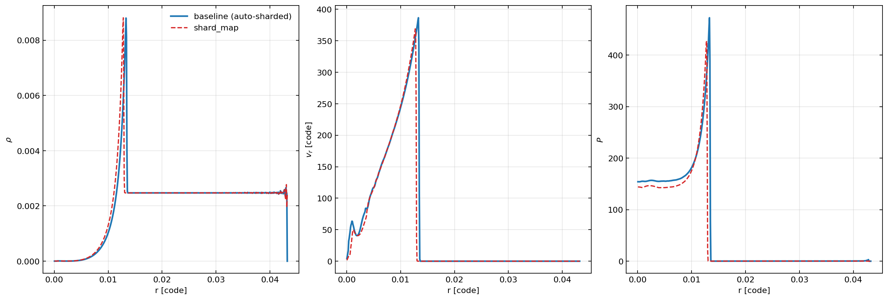

*Sedov 3D 1024³ at t = 10⁴ yr on 32 A100s: shard_map (explicit per-shard `jax.lax.ppermute` halos, red dashed) vs the auto-sharded `NamedSharding + jnp.pad` baseline (blue solid). Radial profiles of density, radial velocity, and pressure overlay: shock peak ρ agrees to **+0.13%** and shock radius to **−3.8%** (≈1 radial bin out of 64). Validates the shard_map refactor while it cuts wall-clock from 6 h 52 min (auto-sharded) to **9 min 17 s** on the same hardware (~44× speed-up, dispatch-fix + JIT-fusion + explicit halo).*


*Subsonic (M_rms = 0.3) driven isothermal turbulence at t ≈ 4 (≈1.2 turnover times): density slice through z = L/2 for a resolution sweep Nx³ ∈ {128³, 256³, 512³, 1024³}. Solenoidal-only OU forcing (Federrath/Schmidt 2010) on a 1³ periodic box, k_min=1, k_max=2 driving range, identical PRNG seed at every Nx so the driven realisation matches. EOS: LUNA solves γ=5/3 Euler internally for HLLC robustness, but the runner enforces p = c_s² ρ as an operator-split post-step projection (soft isothermal thermostat) — no spurious compressive heating accumulates. The 1024³ run is on a 2-node × 4-GPU schedule slot.*


*3D M82-like starburst wind following the Schneider, Robertson & Thompson (2018) CC85 setup: rotating exponential isothermal gas disk (M_gas = 2.5 × 10⁹ M⊙, R_d = 1.6 kpc, R_trunc = 4.5 kpc, T = 10⁴ K) in vertical hydrostatic equilibrium within a static Miyamoto-Nagai stellar disk (M⋆ = 10¹⁰ M⊙, a = 0.8 kpc, b = 0.15 kpc) + NFW halo (M_vir = 5 × 10¹¹ M⊙, c = 20) potential, plus CC85 central spherical injection (R_⋆ = 300 pc; SFR = 12 M⊙/yr, η_M = 0.3, η_E = 0.6 → Ṁ = 3.6 M⊙/yr, Ė ≈ 2.3 × 10⁴² erg/s, v_∞ ≈ 1400 km/s). Hot CGM ambient (n = 10⁻⁴ cm⁻³, T = 10⁶ K) fills the rest of the 10 × 10 × 20 kpc box; Sutherland & Dopita (1993) CIE cooling integrated with Townsend (2009). x–z slice through y = Ly/2 of log₁₀ n_H at t = 60 Myr. Resolution scan Nx ∈ {128, 256, 512}; the 512 panel is a placeholder for a multi-node run still in flight.*

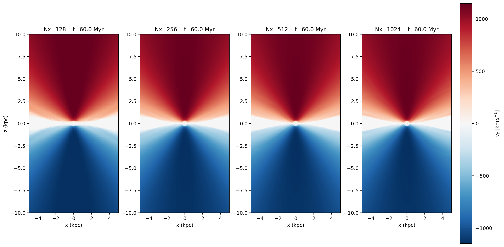

*Same slice and snapshot, showing vertical velocity v_z (km/s) with a diverging colormap. Red is moving upward (+z), blue downward (−z). The bi-conical outflow shows red above the midplane and blue below; surrounding low-magnitude regions are the CGM responding to the wind.*


*Same slice and snapshot, showing log₁₀ T (K). The injection region launches gas at T > 10⁷ K which adiabatically expands and cools above and below the disk. The dense cold disk (T = 10⁴ K floor of the S&D93 cooling table) is the central blue band.*


*Spherically-averaged radial profiles of n_H, v_rad, and T at t = 60 Myr for each resolution. Computed by 3D binning in radius from the box center. Useful for direct comparison against the analytic CC85 solution (n ∝ r⁻², roughly constant v ∝ v_∞ outside R_⋆, and adiabatic T ∝ r⁻⁴ᐟ³ in the steady wind) and Schneider+ 2018 CGOLS Figure 4.*

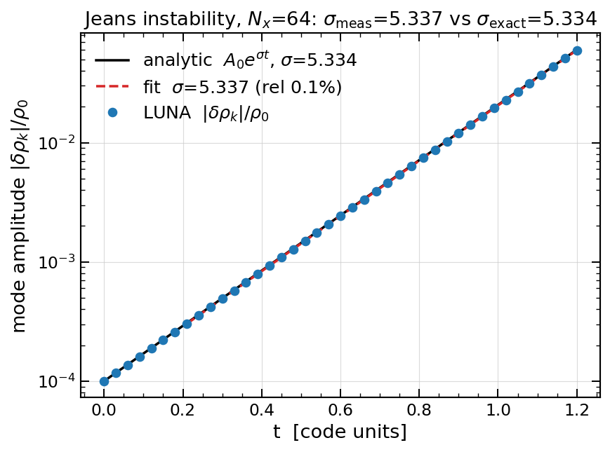

*Linear Jeans instability against analytic linear theory. Periodic self-gravitating box (64³) seeded with the growing Jeans eigenmode (adiabatic δP = c_s²δρ plus the matching longitudinal velocity), so the unstable mode grows as a clean exponential δρ ∝ e^{σt} with σ = √(4πGρ₀ − c_s²k²). LUNA's measured mode amplitude (points) and its log-slope fit track the analytic A₀e^{σt} (black) to **σ_meas = 5.34 vs σ_exact = 5.33 (0.06%)**. The underlying FMG multigrid Poisson solver is itself accurate to 0.08% on the analytic single-mode potential and converges to a 10⁻¹⁴ residual.*

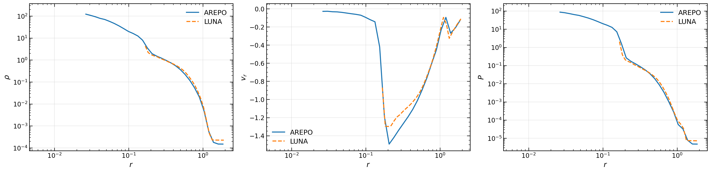

*Evrard 1988 adiabatic spherical collapse vs AREPO (Springel 2010 moving-mesh code) at t = 0.8 (Springel 2010 Fig 41 reference time). Identical ICs in code units (M = R = G = 1, ρ ∝ 1/r, u₀ = 0.05, γ = 5/3) at 64³ in a periodic L = 4 box. LUNA (points) and AREPO (line) agree on ρ, vᵣ, P through the accretion shock at r ≈ 0.15, the vᵣ ≈ −1.4 free-fall envelope, and the static ambient. AREPO's adaptive mesh reaches the post-bounce central density that LUNA's fixed dx = 0.06 grid cannot.*

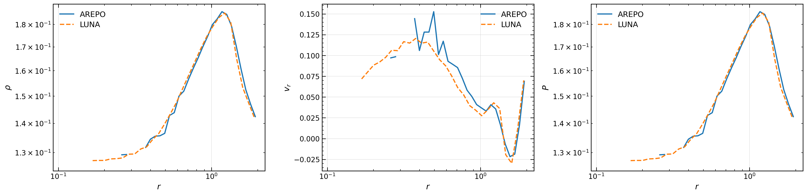

*Sub-critical isothermal Bonnor-Ebert sphere (ξₜ = 5 < 6.451) vs AREPO at t = 3.0, periodic L = 4, c_s² = G = 1. LUNA and AREPO agree on ρ, vᵣ, P throughout; the slow outward drift is the IC's residual edge pressure/gravity mismatch (a periodic-BC artefact, reproduced independently by AREPO).*

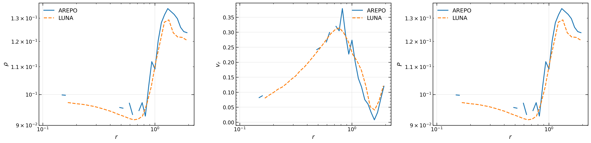

*Super-critical isothermal Bonnor-Ebert sphere (ξₜ = 10 > 6.451) at t = 3.0. Both codes show the same post-bounce outward flow peaking at vᵣ ≈ 0.3; the bulk profiles match to plotting precision.*

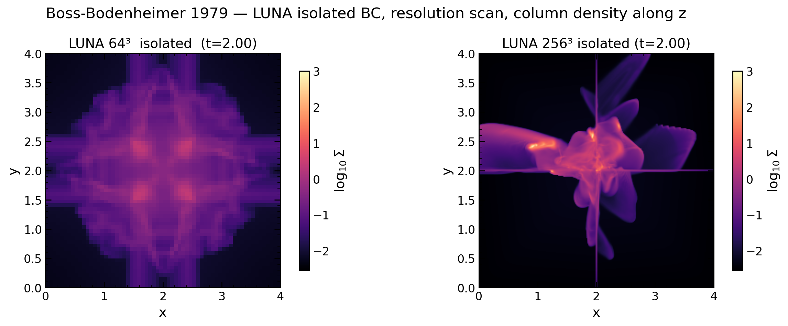

*Boss & Bodenheimer 1979 rotating isothermal collapse with the **isolated** Poisson BC (multipole-Dirichlet halo + outflow hydro, no periodic-image saddle), MinMod limiter, at t = 2.0. Both panels are LUNA: 64³ (left) gives a smooth under-resolved blob, while 256³ (right) resolves the m = 2 rotational-fragmentation morphology — a clumpy central bar with substructure.*

## Differentiable simulation (autodiff)

LUNA's hydro step, gravity solve, and source terms are end-to-end differentiable (JAX), in both forward and reverse mode, through the *production* solver. The tests below first validate the gradients against ground truth, then put them to work: forward-mode parameter sensitivity, reverse-mode inverse problems across physics regimes, a solver-in-the-loop learned correction, and finally the whole thing at multi-GPU scale.

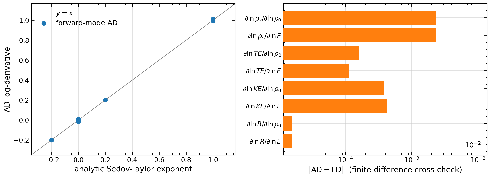

*1. Gradient self-consistency (Sedov-Taylor). Forward-mode AD through the full Sedov blast (32³, 200 steps) reproduces the **analytic** self-similar exponents — ∂lnR/∂lnE = +1/5, ∂lnR/∂lnρ₀ = −1/5, the KE/TE energy partition, the Rankine-Hugoniot density jump — with every point on the y = x line (left), and matches central finite differences to < 10⁻² (right). The gradient is checked against an analytic ground truth, not just FD.*

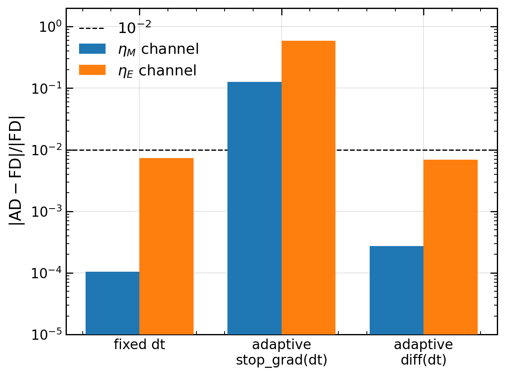

*2. Gradients through adaptive timestepping. ∂lnL_X/∂lnη for the M82 wind (32×32×64, integrated to 10 Myr), AD vs central FD, under three dt treatments. Fixed dt and fully-differentiated adaptive dt are FD-exact (< 10⁻³); `stop_gradient` on the CFL dt drops the dt-sensitivity path (≈ 13 % on η_M, ≈ 59 % on η_E) — so differentiating an adaptive-dt run must either hold dt fixed or differentiate it. (A subtlety not addressed by prior differentiable-hydro work.)*

*3. M82 forward sensitivity — ∂lnL_X/∂lnη_M, ∂lnL_X/∂lnη_E on the developed (10 Myr) wind, the X-ray response to mass- and energy-loading. **Figure in flight** (forward-mode, `diff` dt).*

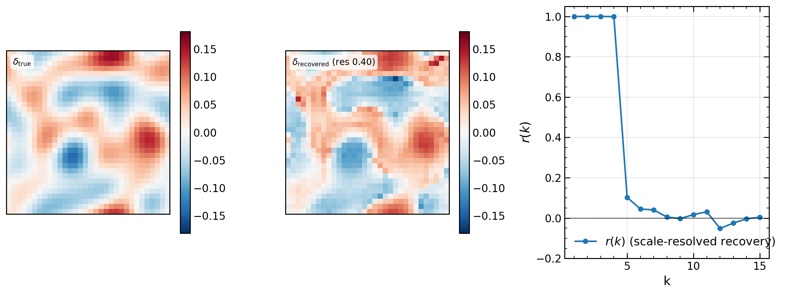

*4. Reverse-mode IC inversion — turbulent flow. Recovering the initial low-k density field from the evolved OU-driven turbulent state (32³) by reverse-mode AD through the production solver. δ_true vs δ_recovered (large scales recovered, fine scales decorrelated); the scale-resolved cross-correlation r(k) ≈ 1 through the forcing band (k ≤ 4) then collapses — the recoverability cliff set by chaotic mixing.*

*5. Reverse-mode IC inversion — self-gravitating flow, through the differentiable FMG-Poisson adjoint. **Figure in flight.***

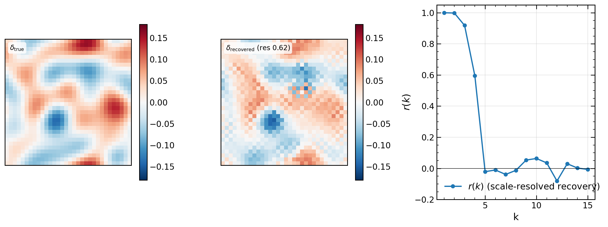

*6. Reverse-mode IC inversion — radiatively cooling flow. Recovering the IC energy perturbation through the cooling solver (uniform box, n_H ≈ 0.05 cm⁻³, T ≈ 2×10⁵ K, evolved ~½ a cooling time). The r(k) cliff at k ≈ 4–5 is the dissipative recovery limit — cooling smooths the small scales. Together with panels 4–5 this mirrors the diffhydro "turbulent, self-gravitating, radiatively cooling" reconstruction trilogy.*

*7. Solver-in-the-loop KH corrector — a CNN flux correction trained reverse-mode through the unrolled coarse rollout (Um+ 2020) to track a 4× fine reference. **Retrain in flight.***

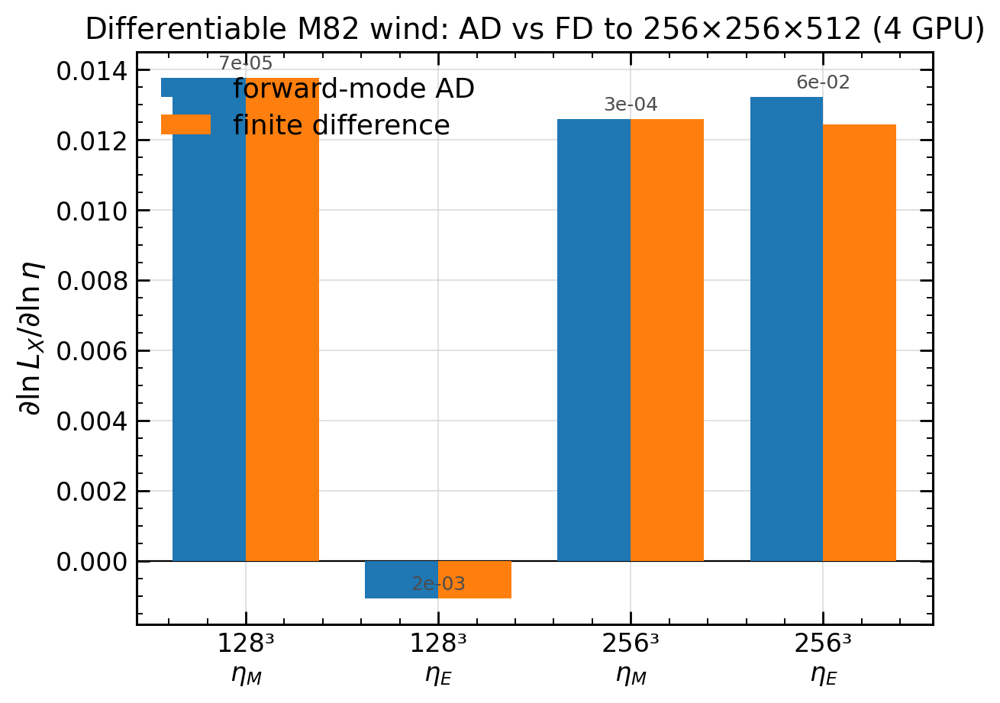

*8. Autodiff at scale. Forward-mode ∂lnL_X/∂lnη on the M82 wind at **256×256×512 across 4 GPUs** (auto-sharded), FD-validated (η_M to a relative 3×10⁻⁴) — differentiable simulation at diffhydro-parity resolution on multiple devices.*

**Key Features:**
- ✅ Single-GPU and multi-GPU (JAX sharding) execution
- ✅ HLLC Riemann solver with optimized flux computation
- ✅ PLM reconstruction with multiple limiters
- ✅ Smooth limiters for automatic differentiation
- ✅ Full autodiff support with gradient visualization
- ✅ Unsplit 2nd-order MUSCL-Hancock time integration (RAMSES-style primitive predictor)

---

## Table of Contents

1. [Quick Start](#quick-start)
2. [Single-GPU Usage](#single-gpu-usage)
3. [Multi-GPU Usage](#multi-gpu-usage)
4. [Performance](#performance)

---

## Quick Start

### Setup

1. **Configuration**: Copy the template configuration file:
   ```bash
   cp template_config.py config.py
   ```
   Edit `config.py` to set your simulation parameters (grid size, test problem, etc.)

2. **Dependencies**:
   ```bash
   pip install jax jaxlib numpy h5py matplotlib
   ```

### Run Simulation

```bash
# Single- or multi-GPU: main.py initializes JAX distributed automatically
# (single process uses all visible GPUs; under SLURM, srun spawns one
# process per GPU and they coordinate via JAX_COORDINATOR_PORT).
python main.py

# Validation problems run through the runner instead (see submit/ for
# SLURM templates):
python -m scripts.validation.runs.sedov3d_run
```

---

## Single-GPU Usage

### Configuration

`config.py` is a dataclass (copied from `template_config.py`); edit the field
defaults. The knobs that matter most:

- **Test problem**: `test_problem` — any name registered in
  `ic_generation/ic.py` (e.g. `"Sod-Shock"`, `"Kelvin-Helmholtz"`,
  `"Sedov-Blast-3D"`, `"Boss-Bodenheimer-3D"`, `"CC85-Wind-3D"`)
- **Dimension / grid**: `SPATIAL_DIMENSION`, `Nx/Ny/Nz`, `Lx/Ly/Lz`
- **Scheme** (time integration is always unsplit MUSCL-Hancock):
  - `ORDER` — 0 = first-order Godunov, 1 = PLM (2nd order, default)
  - `LIMITER` — 0 = MinMod, 1 = MonCen, 2 = VanLeer
  - `riemann_solver` — `"hllc"` (default), `"hll"` (more dissipative),
    `"lhllc"` (low-Mach fix for stratified/subsonic flows)
  - `CFL` — 0.3–0.5 for 3D unsplit; up to 0.8 for 1D
- **Boundaries**: `BOUNDARY` — 0 = periodic, 1 = outflow/zero-gradient,
  2 = reflective
- **Self-gravity**: `SELF_GRAVITY=True` + `GRAVITATIONAL_G`;
  `POISSON_BOUNDARY` — inherit (None), 0 = periodic (Jeans swindle),
  3 = isolated (multipole-Dirichlet FMG)

### Example Configuration

```python
# config.py — fields inside the Config dataclass
test_problem: str = "Kelvin-Helmholtz"
SPATIAL_DIMENSION: int = 2
Nx: int = 2048
Ny: int = 2048
Lx: float = 1.0
Ly: float = 1.0
t_end: float = 2.0
CFL: float = 0.5
ORDER: int = 1        # PLM
LIMITER: int = 1      # MonCen
BOUNDARY: int = 0     # periodic
```

### Run Simulation

```bash
python main.py
```

For parameter sweeps and validation problems, skip `config.py` and use the
programmatic runner, which applies overrides on top of the template:

```python
from scripts.validation.runner import run_one
run_one(dict(test_problem="Sedov-Blast-3D", Nx=256, Ny=256, Nz=256, ...))
```

---

## Multi-GPU Usage

###  Overview

LUNA has two multi-GPU execution paths:

1. **Auto-sharding (default)** — arrays carry a `NamedSharding`; XLA inserts
   the halo communication automatically. Fine for 2D and small 3D runs.
2. **shard_map (production 3D)** — set `USE_SHARDMAP=True`. The whole
   MUSCL-Hancock step runs per-shard with explicit `ppermute` halo
   exchanges. This sidesteps XLA's auto-sharding working-set blowup and is
   what the 1024³ production runs use.

Mesh decomposition is controlled by `DECOMPOSITION` ("auto"/"slab"/"block")
or pinned exactly with `MESH_SHAPE` (e.g. `(2, 2, 4)` for 16 GPUs on 1024³).

### Quick Start

```bash
# Single node: JAX automatically uses all visible GPUs
python main.py

# Multi-node under SLURM: one process per GPU via srun (see submit/ templates)
srun python -u -m scripts.validation.runs.sedov3d_run
```

### Multi-process rules (hard-won)

- Build per-cell sharded arrays from local slices via
  `make_array_from_single_device_arrays` — a full-array `device_put`
  deadlocks silently multi-node.
- Pass sharded arrays as JIT *arguments*, never capture them in Python
  closures (XLA tries to inline them as constants and crashes).
- 1024³ float32 3D needs ≥16 GPUs with `MESH_SHAPE=(2, 2, 4)`; the MUSCL
  working set (~23 full-shard arrays) does not fit 8 A100-40GB.

---

## Production usage

For long-running production campaigns:

- **NaN abort guard**: the time loop checks for non-finite state after every step (free piggyback on `compute_dt`). On detection it retries the step with halved CFL up to **8 times** (i.e., `dt → dt/256`). If the state is still bad it dumps an emergency checkpoint (`cfg.enable_checkpointing` is default-on) and raises `RuntimeError` so SLURM exits non-zero. No more silent multi-hour NaN'd runs.
- **Periodic diagnostics**: every `cfg.diag_interval` steps the runner prints `min(rho), min(P), max(|v|), max(M)` and appends a row to `<output_dir>/history.csv` (Athena++-style `.hst` analog) for offline analysis.
- **Determinism**: validated submit scripts in `submit/` export `XLA_FLAGS="--xla_gpu_deterministic_ops=true"`. Together with `enable_x64=True` (set in run scripts) this gives bitwise-reproducible runs at fixed sharding.
- **Source terms** live in `sources/` (`ou_forcing`, `cc85`, `external_gravity`, `cooling`, `self_gravity`). Each returns a `{"apply": fn(U, dt)}` callable that the runner operator-splits after the hydro step. Adding a new source term means writing one `sources/X.py` and one line in `setup/runner_distributed.py`.
- **Multi-node**: the validated pattern (`submit/submit_m82_multi.sh`, `submit/submit_kh_multi.sh` and the other `*_multi`/`*_8node` scripts) uses `--mem=500000`, `--constraint=gpu`, `--gres=gpu:4`, `JAX_COORDINATOR_PORT=12345`. SLURM logs land in `slurm_logs/`. Lessons from earlier multi-node debugging:
  - Build all sharded auxiliary arrays via the KH-IC pattern (local-slice + `make_array_from_single_device_arrays`); naïve full-array `device_put` deadlocks multi-process.
  - Pass sharded arrays as JIT *arguments*, not as Python closures — XLA tries to inline closure-captured sharded arrays as MLIR constants and crashes with "Fetching value for jax.Array that spans non-addressable devices".

---

## Performance

### Single-GPU Optimization

**Optimizations completed:**
1. ✅ Specialized 1D/2D/3D HLLC functions (memory-friendly per-component
   `jnp.where` chains instead of stacked intermediates)
2. ✅ Direction-by-direction predictor accumulation with
   `optimization_barrier` (3D working set never holds three slope arrays)
3. ✅ Optimized reflective boundaries
4. ✅ Reciprocal caching in HLLC

**Measured:** ~12% HLLC speedup from the flux rework (2.86 ms → 2.52 ms
per flux call on a 4096² grid, A100).

### Multi-GPU Scaling

Early 2D auto-sharding measurements (2048² strong scaling on one A100 node)
showed ~95% efficiency at 2–8 GPUs. For production 3D the relevant numbers
are from the shard_map path:

- **Sedov 1024³ float32**: runs on 16 A100-40GB (4 nodes × 4),
  `MESH_SHAPE=(2, 2, 4)`, `USE_SHARDMAP=True`. 8 GPUs OOMs — the unsplit
  MUSCL working set needs the 16-GPU shard size.
- shard_map vs auto-sharding at the same node count gave a major step-time
  improvement at 1024³ (XLA's auto-sharded 3D step materializes large
  scratch buffers that the explicit per-shard pipeline avoids).
- Keep ≥256³ cells per GPU for good compute/halo ratio.

---

## Citation

If you use this code in your research, please cite:

```bibtex
@software{luna,
  author = {Your Name},
  title = {LUNA: A Differentiable Astrophysical MHD Code},
  year = {2025},
  url = {https://github.com/yourusername/luna}
}
```

---

## License

[Add your license here]

---

## Contributing

Contributions welcome! Please:
1. Fork the repository
2. Create a feature branch
3. Add tests for new features
4. Submit a pull request

---

## Support

For questions or issues:
- Open an issue on GitHub
- Check this documentation

---

**Last Updated:** 2025-12-02
**Status:** Production-ready for single-GPU, multi-GPU (JAX sharding) works on NVIDIA, issues on AMD ROCm
