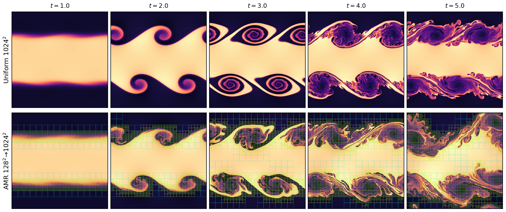
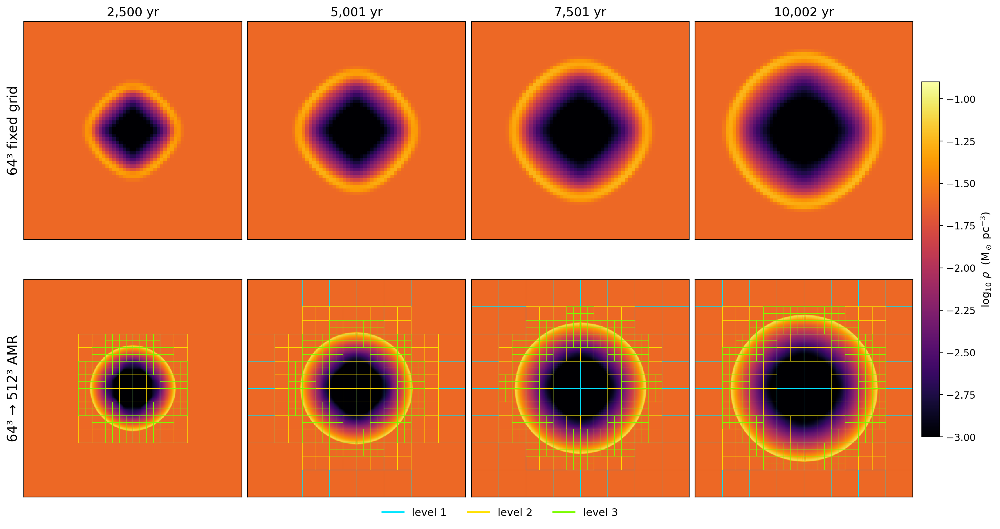
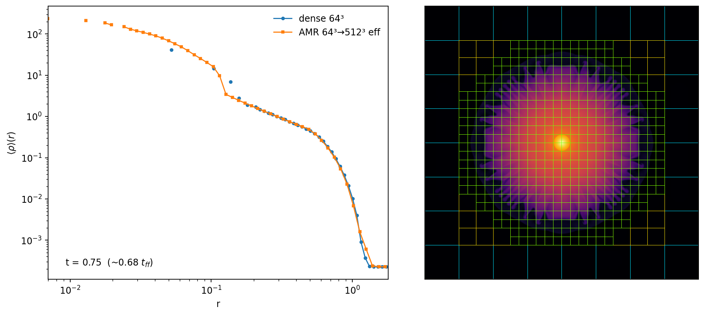

# Block-AMR (experimental)

A LUNA-native, dimension-generic block-structured AMR layer (`luna/amr/`), wired
through `main.run` via `cfg.AMR=True` → `luna/setup/runner_amr.py`. Everything is pure
JAX (jit/vmap/scan/shard_map).

**Validation — Kelvin-Helmholtz to t=5, AMR (128² base → 1024² effective) vs uniform 1024²:**

Refinement mesh overlaid on the AMR panels (block edges colored by level). The AMR
refines the shear sheets while the flow is laminar (t=1), then **dynamically tracks
the vortices** as they roll up (t=2–3) and the mixing layer as it goes turbulent
(t=4–5). Fields match the uniform run through the linear/early-nonlinear phase;
late-time pointwise divergence is expected (KH turbulence is chaotic), with the
large-scale structures consistent.

**Validation — 3D Sedov-Taylor SN blast in physical units (AREPO: pc, km s⁻¹, M⊙; 10⁵¹ erg into an n=1 cm⁻³, 10⁴ K ISM), AMR (64³ base → 512³ effective) vs uniform 64³:**

Central z=Lz/2 density slice (log scale) at 2500 / 5000 / 7500 / 10000 yr. The uniform
64³ shock is a blocky Cartesian diamond; the AMR — identical base resolution and physics
— resolves a crisp spherical shell. The refinement mesh (block edges colored by level)
**hugs the shell**: the combined criterion (relative ∇P, OR relative ∇ρ gated by
overdensity) refines the shock and compressed shell while the smooth hot interior
de-refines back to the coarse levels as the remnant expands. Shell density jump ≈4× (the
γ=5/3 Sedov strong-shock limit), NaN-free, reflection-symmetric to <0.02%, and the full
64³→512³ run takes ~400 s on a single A100.

**Validation — self-gravitating collapse on AMR: Evrard spherical collapse, 64³ base → 512³ effective:**

Cold spherical cloud in free-fall self-gravity, at t = 0.75 (~0.68 t_ff). **Left:** the
spherically-averaged density profile — the AMR run (orange) matches the dense 64³ reference
(blue) from the envelope through the accretion-shock break at r≈0.12, then continues the
collapse profile **another decade inward** where the fixed 64³ hits its resolution floor
(core ρ≈236 vs 41). **Right:** the mesh — nested quasi-Lagrangian refinement (level 1 cyan,
2 yellow, 3 green) wraps the cloud and piles onto the collapsing core, ambient stays coarse.
This is the AMR hierarchy coupled to the **level-by-level Dirichlet multigrid Poisson solver**
(`luna/amr/poisson.py`): L0 by the dense FMG, refined levels by within-block V-cycles with
linearly-prolonged Dirichlet ghosts — gravity + hydro + dynamic regridding all cooperating.
Validated on Jeans growth (dense 64³ +0.06%, AMR full chain +0.55% of the analytic σ).

**What works (2D + 3D, end-to-end through `main`):**
- Block layer: x64 Morton ids, conservative prolong/restrict, O(N log N) neighbour
  finding, NaN-sentinel padding.
- Hydro on blocks: per-block MUSCL-Hancock; same-level seam fluxes (mass & energy
  conserved to machine precision); coarse-fine reflux.
- Dynamic regridding on the live solution. `amr_criterion` is pluggable:
  `"density"` (|grad ρ|, the default), `"vorticity"` (|curl v|), `"pressure"`,
  `"pressure_density"`/`"prho"` (relative ∇P OR gated ∇ρ), `"overdensity"`,
  `"jeans"`, `"lohner"`, or `"static"`.
- Subcycling (Berger-Oliger): level L advances at `dt_base / 2**L`, with
  time-accumulated coarse-fine reflux default-on in both the synchronized and
  subcycled integrators.
- Multi-GPU via `jax.shard_map` (1-GPU-per-process): blocks sharded across devices.
  `amr_shard=1` on 2 processes, on 1 process with 2 GPUs and on 1 GPU gives the
  same snapshots bit for bit (3D Sod, 2 levels, measured on 2 MI300A;
  `tests/test_amr_multiprocess.py` checks 2 processes against 1 on CPU).
  Two ROCm traps, both handled in the code: jax 0.10.2's copy race hung the
  halo-plan build (`AMD_SERIALIZE_COPY=3`, set by `luna/setup/jax_init.py`,
  docs/ENV.md), and XLA's multi-process sharded autotuning left both ranks
  waiting for each other while compiling the chunk (4 of 12 fresh compiles,
  jax 0.10.0), so the chunk is compiled with `xla_gpu_shard_autotuning` off
  when there is more than one process (`luna/setup/runner_amr.py`).

**Config knobs** (`luna/template_config.py`, the `amr_*` block): `AMR`, `amr_levels`,
`amr_block_shape`, `amr_criterion`, `amr_thresholds`, `amr_subcycle`,
`amr_shard`, `amr_regrid_interval`, `amr_block_bucket`, `amr_max_blocks`,
`amr_capacities`, `amr_rho_floor`, `amr_rho_floor_frac`, `amr_p_floor`,
`amr_dense_snapshots` — see the commented template for semantics.

**Benchmark — KH to t=5 on 4×A100 (measured Mcells/s):** at a saturating base
(1024²) the AMR compute runs at ~90% of the dense path (~750 vs ~830 Mcells/s);
the remaining overhead is the full-hierarchy regrid on the base-step cadence.

**Open / next:** cosmological hardening (DM coupling on AMR exists via `luna/amr/particles.py`
but has no end-to-end test; dual-energy on AMR not yet implemented); distributed-performance work at small per-GPU loads
(a dense base level stepped by the dense solver, with the refined levels as
blocks: the design is in `src/luna/amr/DESIGN.md`; the prototype was removed
from the tree, see git history).
